# 我的商大 · HarmonyOS

浙江工商大学移动门户「我的商大」的 HarmonyOS ArkTS 社区适配版。项目使用原生 ArkUI 搭建底部导航与页面框架，通过 ArkWeb 承载学校官方 H5 业务，登录、数据与业务请求均直连学校官方系统。

> 本项目由社区爱好者开发，**并非学校官方应用**。应用内所有业务内容、商标与校园素材版权归浙江工商大学及相关权利方所有。


## 应用简介

「我的商大」是浙江工商大学的统一移动门户，提供校园码、教务查询、成绩查询、资讯、审批、通讯录等服务。本应用面向 HarmonyOS 设备，将官方移动门户的 H5 页面封装为原生体验：

- 使用原生底栏与标题栏，避免网页嵌套带来的割裂感；
- 复用学校统一身份认证，不搭建任何中间服务器；
- 针对 zfsoft 门户与通讯录 H5 补充 Android 桥兼容层，使二级页面、分享、版本检测等功能在 HarmonyOS 上可用；
- 在网络不稳定时优先展示本地缓存，并在网络恢复后自动重连。

## 界面预览

| 首次启动 · 隐私声明 | 登录页 | 主页 |
| :---: | :---: | :---: |
| 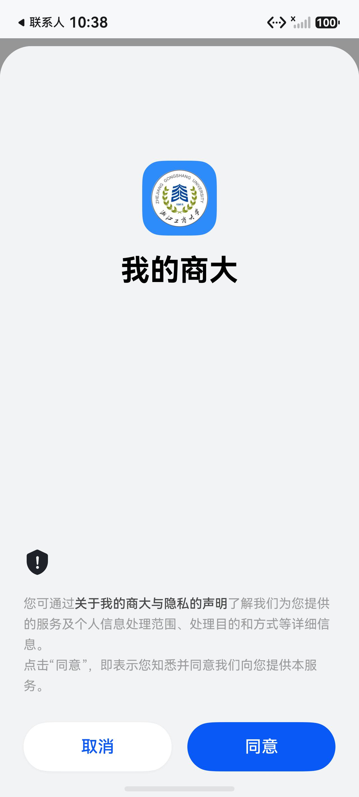 | 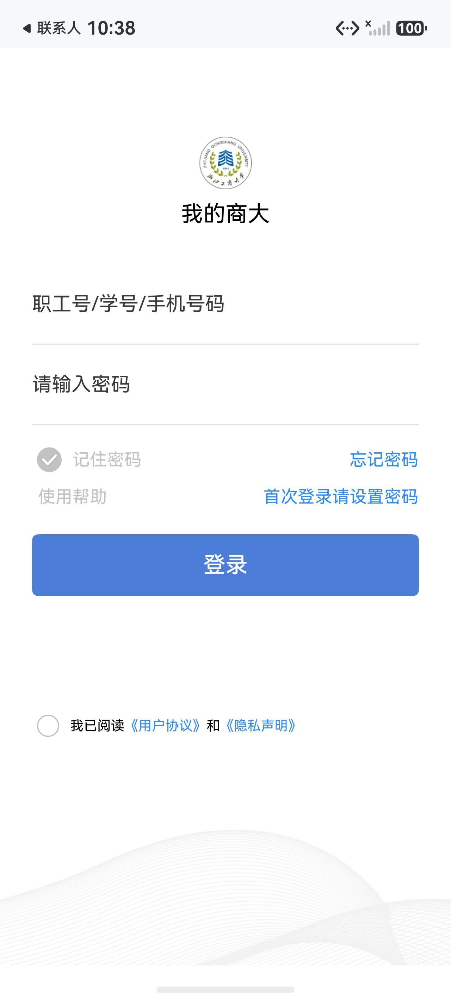 | 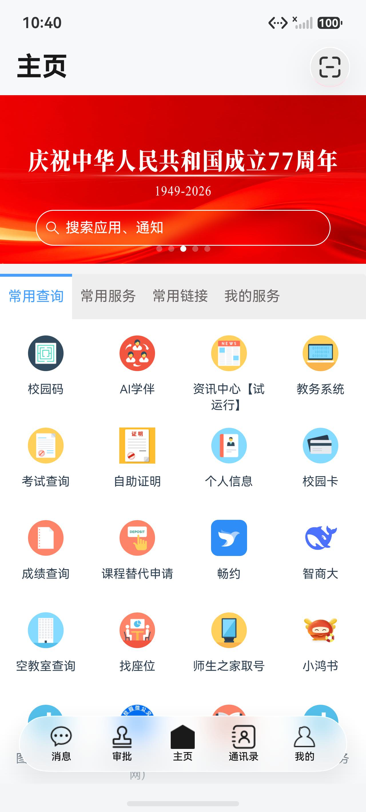 |

| 资讯中心 | 消息 | 审批 |
| :---: | :---: | :---: |
| 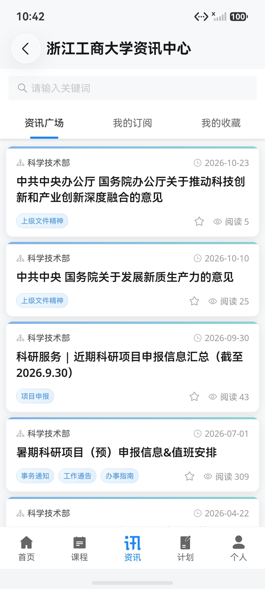 | 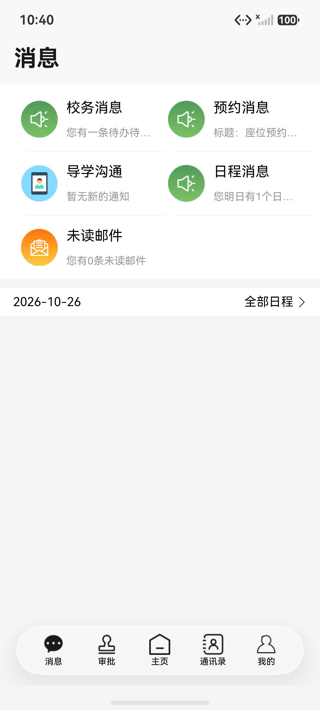 | 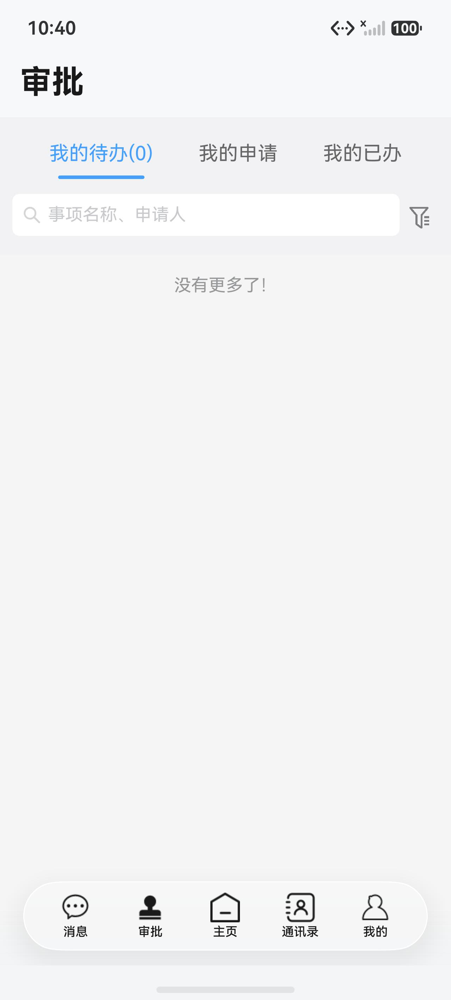 |

| 通讯录 | 我的 | 设置 |
| :---: | :---: | :---: |
| 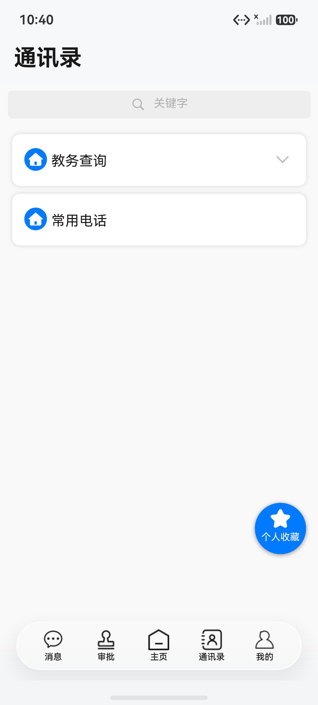 | 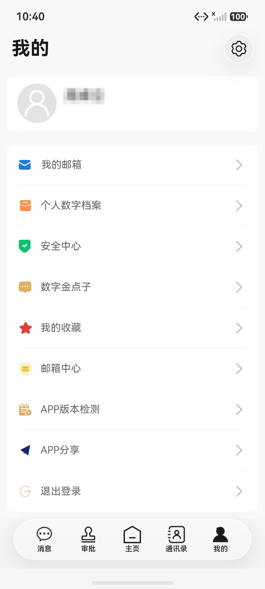 | 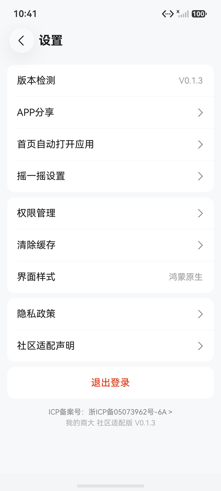 |

| 关于与隐私说明 |
| :---: |
| 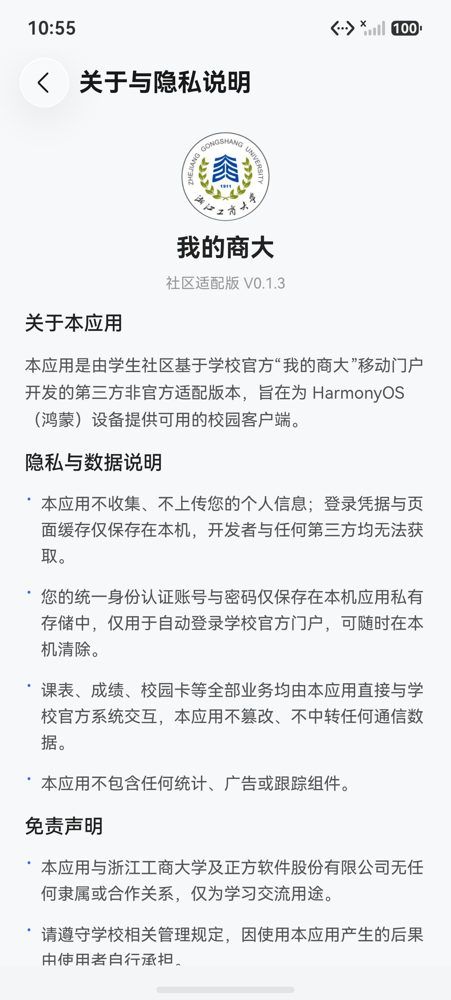 |

## 宣传图

4:3 宣传图位于 [`docs/promo`](docs/promo)，可直接用于社区分享。

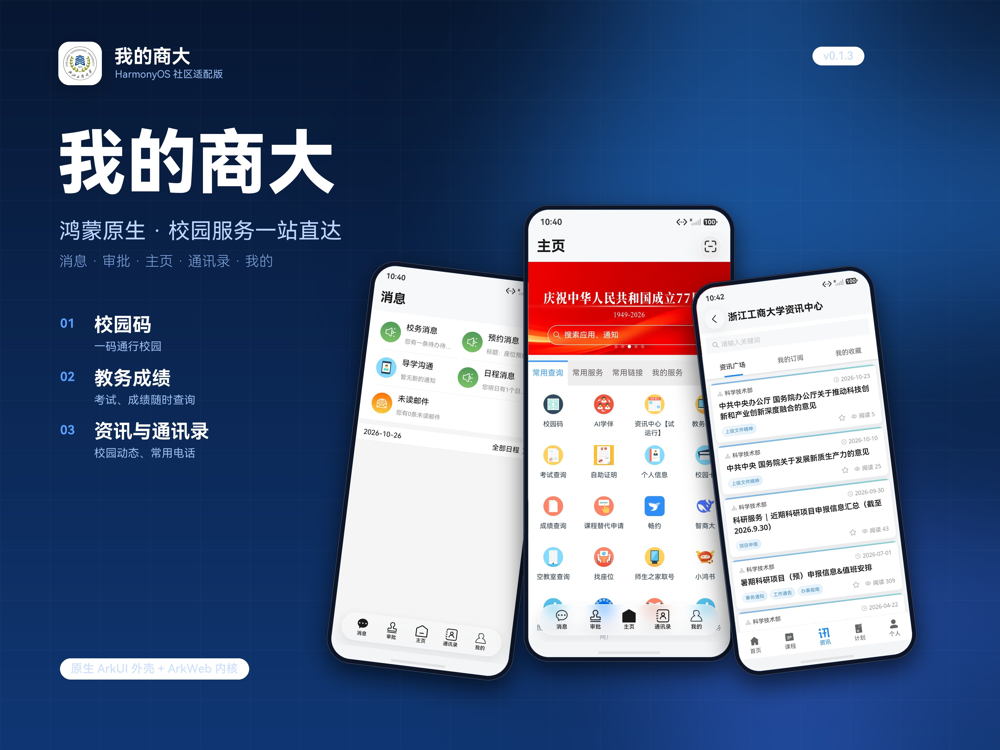

| 功能总览 | 离线能力 | 隐私说明 |
| :---: | :---: | :---: |
| 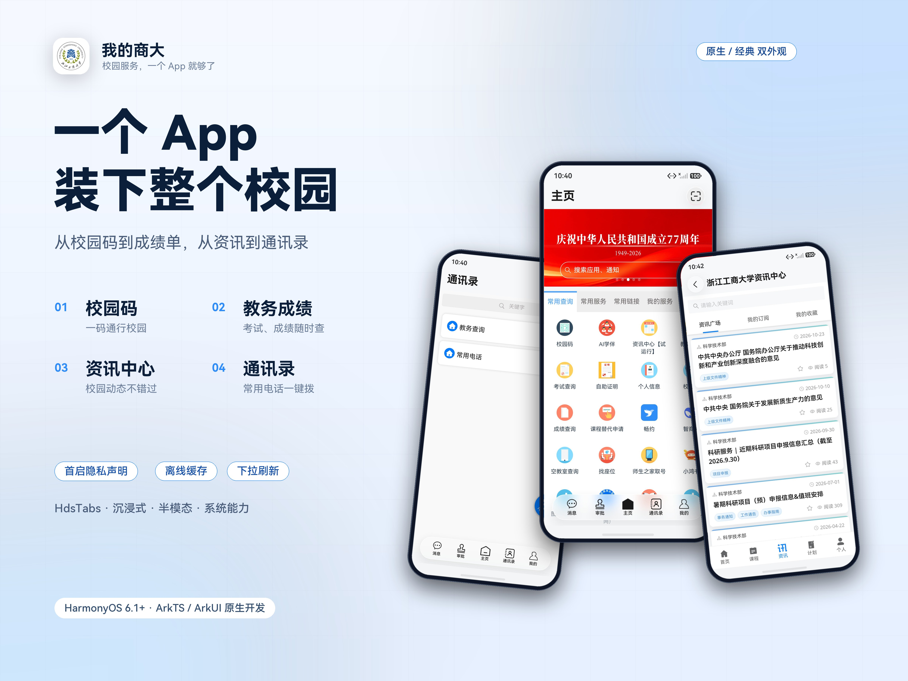 | 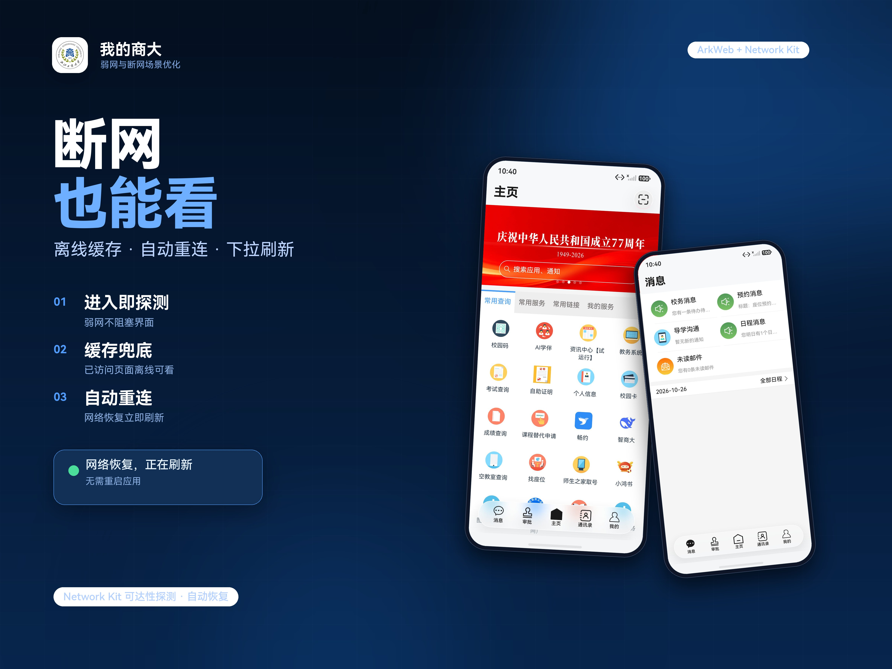 | 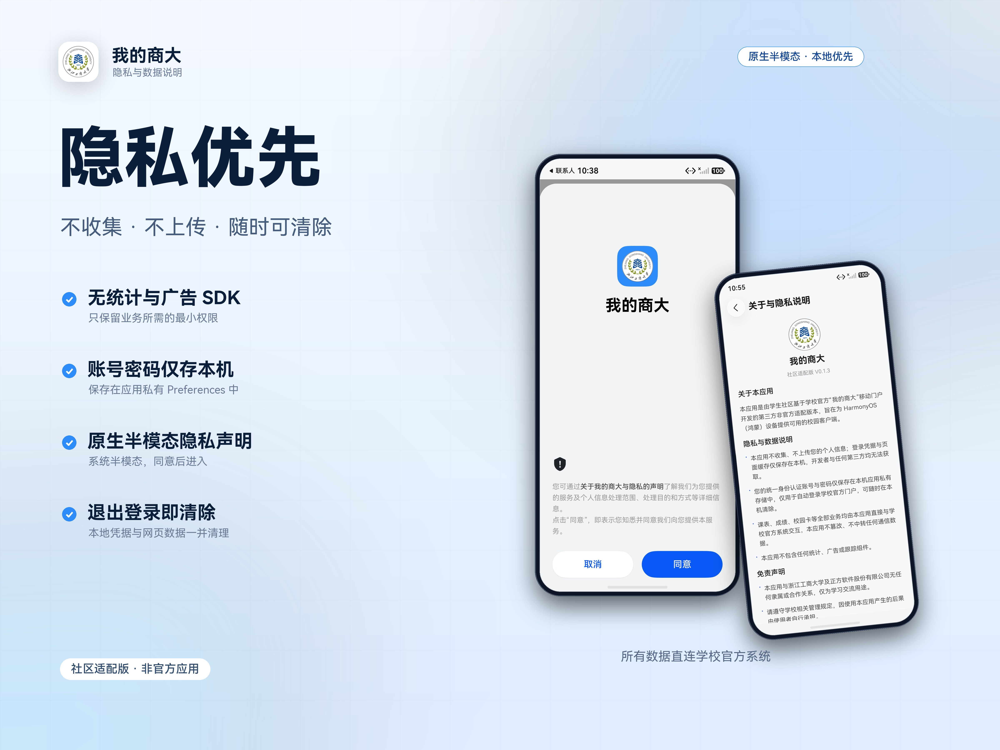 |

| 鸿蒙原生适配 | 原生 / 经典双外观 |
| :---: | :---: |
| 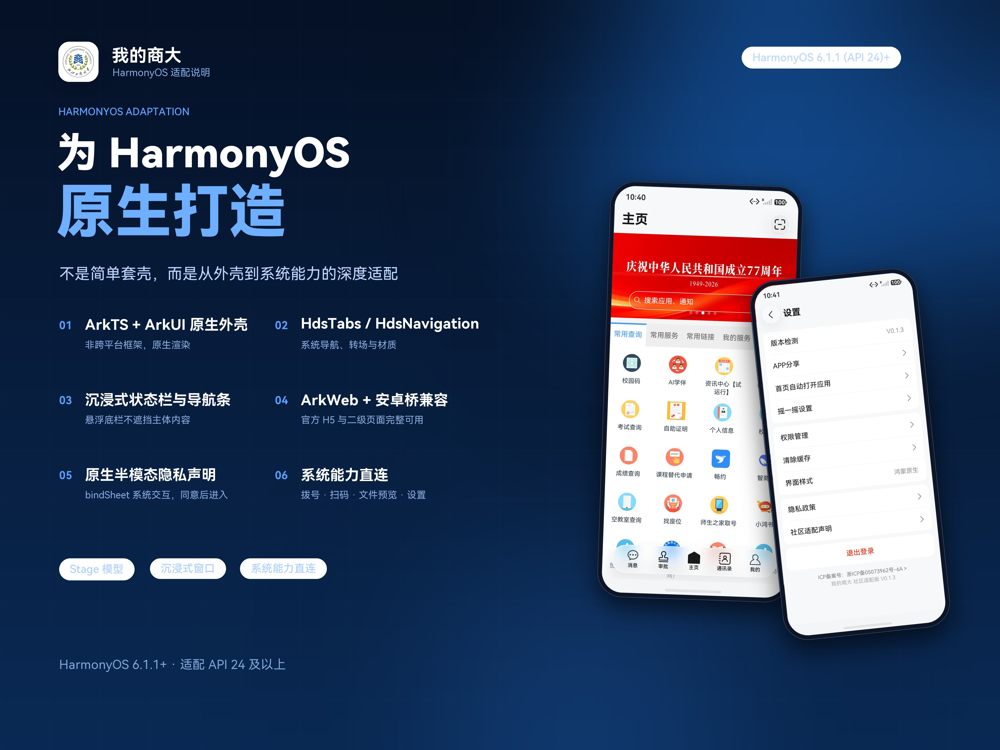 | 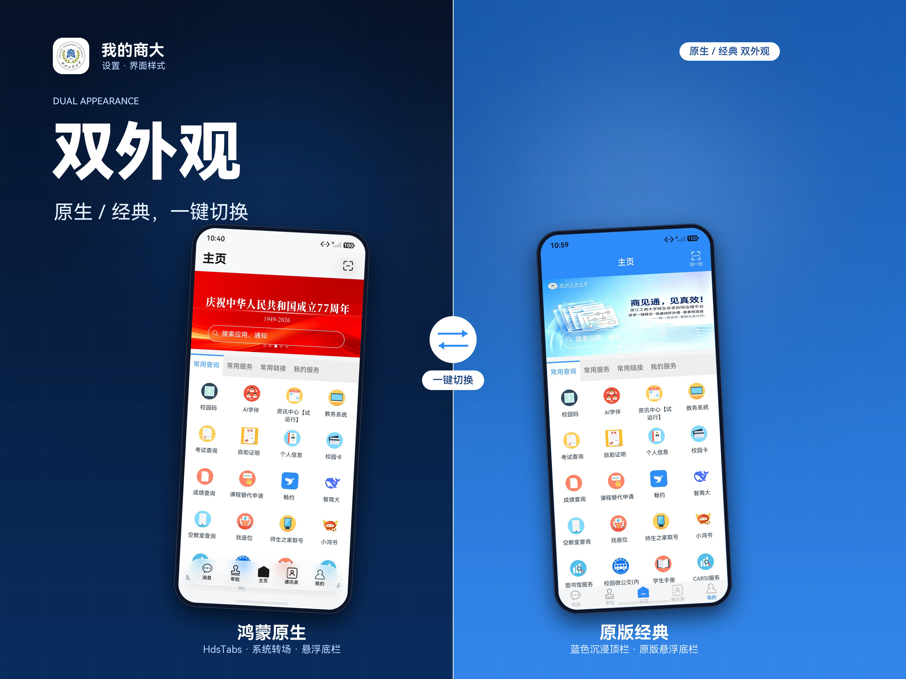 |

## 应用特色

### 原生外壳，网页内核

- 底部导航：消息、审批、主页、通讯录、我的，对应门户的五个主入口。
- 首页、审批、消息、我的提供原生骨架，业务列表仍由官方 H5 渲染，保证信息与学校系统实时一致。
- 子页面使用 `NavDestination` 独立承载，支持标题栏、返回手势与深链打开。

### 双外观样式

设置中可切换「鸿蒙原生」与「经典」两套外壳：

- **鸿蒙原生**：使用 `HdsTabs` / `HdsNavigation`，配合系统材质与悬浮底栏，状态栏与底部小白条沉浸显示。
- **经典**：保留原版 App 的顶部渐变标题栏与方形图标风格。

切换后主页、子页面、设置页会同步应用对应外壳。

### 快速登录与自动登录

- 首次启动直接使用原生登录页，校验通过后再进入门户，避免网页登录页反复跳转。
- 支持「记住密码」，凭据保存在应用私有 Preferences 中，仅用于向学校统一身份认证提交。
- 门户 H5 需要登录态时，注入脚本会等待 RSA 公钥就绪并检测验证码状态，满足条件后自动提交，否则回退到网页登录页。
- 设置页提供「退出登录」，可清除本地保存的凭据与网页数据。

### 离线优先与自动重连

- 启动与切换 Tab 时先探测网络，弱网或断网立即进入离线缓存模式，不阻塞界面。
- 注入 `fetch` / `XMLHttpRequest` 缓存层，将成功响应写入本地缓存，断网时由缓存兜底。
- 页面顶部显示离线提示条，点击即可重连；网络恢复后自动重新加载在线页面，无需重启应用。
- 页面长时间无响应时展示重试界面并提供下拉刷新。

### 移动端能力补齐

- 通讯录、教务查询中的电话号码可直接拉起系统拨号盘。
- 权限管理可跳转到系统应用详情页，便于手动授予权限。
- 支持文件下载、系统文件预览、扫码、摇一摇打开校园码。
- 兼容 zfsoft 门户与通讯录 H5 的 Android 桥，补充二级页面、分享、版本检测等能力。

### 课表桌面卡片

- 三种尺寸：1×2 只看「此刻」，2×2 看今天剩余课程，2×4 带时间地点与剩余节数。
- 数据来自门户首页课表，加载完成后静默抓取落盘，断网时卡片仍可显示最后一次结果。
- 点击卡片直接回到 App 的主页。
- 配套的「上课提醒」在未来三天按课表提前 10 分钟提醒，重新抓取课表时自动重排。

### 隐私友好

- 首次启动展示系统半模态隐私声明，用户同意后才进入应用。
- 不接入统计、广告或第三方 SDK，不上传任何业务数据。
- 所有账号、密码与缓存均保存在设备本地，可在设置中清除。

## 更新说明

### 0.2.0 — 2026-10-26

本版把两份独立实现的社区适配版合并成一份：以本仓库为框架，吸收了另一份实现里
更有价值的增强能力。

- **新增课表桌面卡片**：2×2 小卡、2×4 大卡与 1×2 迷你卡三种尺寸，显示「上课中 / 下节 / 今天已上完」，
  卡片数据由首页自动抓取并缓存到本机，断网也能看。
- **新增上课提醒**：按课表在未来三天提前 10 分钟发本地提醒，课表更新时自动重排，不碰用户自己的日历提醒。
- **凭据加密存储**：账号密码改用 HUKS（AES-256-GCM，密钥不可导出）加密后落盘，
  旧版本的明文凭据会在首次读取时自动迁移。
- **修复「我的」页退出登录无反应**：H5 的退出登录走的是桥方法 `exitLogin`，此前是空实现，
  点击被静默吞掉；现在补上确认弹窗、清 Cookie 与本地凭据，并回到登录页。
- **子页面也能扫码**：扫码能力从「只在主页顶栏」扩展到网页桥（子页面 H5 调扫码同样生效），
  子页面标题栏也增加了扫一扫入口。
- **修复学生手册、校车时刻表等附件入口**：这类条目给的是 pdf/doc/zip 直链，
  现在统一由原生下载后调用系统预览打开，不再丢进 WebView 里白屏。
- **修复误报「离线模式」**：只有真正断网才显示离线提示；有网但页面打不开时显示失败原因，不再误导。
- 新增「社区适配」页：集中放置下载站、开源仓库与作者联系方式，设置页与关于页均可进入。
- 版本号改为从包信息动态读取，不再写死在界面里。

### 0.1.3 — 2026-10-26

- 修复 ArkWeb `src` 自动加载与手动 `loadUrl` 并发导致的 `ERR_ABORTED`，解决多次启动后白屏、进度条停滞的问题。
- 改为单次加载 + 看门狗探测：4 秒无有效进度即回退离线页，约 7 秒内给出结果。
- 未连通时直接进入离线缓存模式，不再等待用户手动选择；联网后自动重连并恢复在线页面。
- 增加下拉刷新、加载失败重试与离线提示条。
- 自动登录会等待 RSA 公钥与验证码状态就绪后再提交，减少登录卡住的情况。
- 通讯录电话支持直接拨号；权限管理支持跳转系统设置。
- 原生样式下子页面同步使用原生标题栏；优化悬浮底栏与系统导航条的沉浸效果。
- 修复「主页自动打开」开关状态不同步、通讯录二级页无法进入等问题。
- 「关于应用」「APP 分享」「APP 版本检测」等入口补齐。

### 0.1.2

- 新增经典外壳样式切换，并同步状态栏沉浸效果。
- 通讯录支持二级页面、搜索与个人收藏。
- 首页自动打开子页面的设置状态保持同步。
- 我的页 APP 分享、版本检测桥接实现。
- 原生样式下子页面使用原生壳。

### 0.1.1

- 网页加载改为离线优先，断网时展示缓存页面。
- 首启隐私声明改为系统半模态样式。
- 修复 Android 桥 stub 回归问题。

### 0.1.0

- 首个可用版本：原生五 Tab 外壳、统一身份认证登录、ArkWeb 承载门户。

## 技术栈

| 分类 | 技术 |
| --- | --- |
| 语言 | ArkTS |
| UI 框架 | ArkUI 声明式开发、`HdsTabs` / `HdsNavigation`（UIDesignKit） |
| 网页容器 | ArkWeb（`Web`、`WebviewController`、JavaScript 注入、原生代理注册） |
| 网络 | Network Kit（`http`、`connection`） |
| 数据存储 | ArkData Preferences、Web 缓存、localStorage 缓存层 |
| 系统能力 | TelephonyKit、ScanKit、PreviewKit、CoreFileKit、SensorServiceKit、NotificationKit |
| 设备适配 | 沉浸式窗口（`window`）、状态栏/导航条避让、深浅色资源 |
| 日志 | PerformanceAnalysisKit（hilog） |
| 构建 | DevEco Studio / hvigor，Stage 模型 |

## 目录结构

```text
.
├── AppScope/                     # 应用级配置与图标
├── entry/
│   ├── src/main/
│   │   ├── ets/
│   │   │   ├── common/           # 常量、路由、原生 API、Preferences、课表类型、凭据保险箱
│   │   │   ├── pages/            # 登录、首页、消息、审批、我的、设置、子页、社区适配
│   │   │   ├── service/          # 注入脚本（Android 桥、自动登录、网络缓存）、课表抓取、附件打开、扫码
│   │   │   ├── view/             # 标题栏、底栏、WebTab 等组件
│   │   │   └── widget/           # 课表桌面卡片（FormExtensionAbility + 三种尺寸 UI）
│   │   ├── resources/            # 图片、颜色、隐私与协议页面
│   │   └── module.json5
│   └── build-profile.json5
├── docs/screenshots/             # README 截图
├── build-profile.json5           # 工程与产物配置（不含签名信息）
└── oh-package.json5
```

## 构建与运行

环境要求：

- DevEco Studio 6.1 及以上
- HarmonyOS SDK 6.1.1（API 24）及以上，目标 API 26
- 一台 HarmonyOS 真机或模拟器

命令行构建：

```bash
hvigorw assembleHap --mode module -p product=default -p buildMode=release --no-daemon
```

产物位于：

```text
entry/build/default/outputs/default/entry-default-signed.hap
```

仓库不包含任何签名证书。首次打开工程时，请在 DevEco Studio 中进入 **File → Project Structure → Signing Configs**，勾选自动签名或配置自己的证书。

安装与启动：

```bash
hdc install -r entry/build/default/outputs/default/entry-default-signed.hap
hdc shell aa start -a EntryAbility -b com.courier.myshangda
```

## 使用说明

1. 首次启动阅读并同意隐私声明。
2. 在登录页输入学校统一身份认证的学号 / 工号与密码，可选择记住密码。
3. 登录成功后进入主页，底部导航可切换消息、审批、主页、通讯录、我的。
4. 设置页可切换界面样式、清理缓存或退出登录。

## 隐私与免责声明

- 应用不收集、不上传任何个人信息，也不包含统计或广告 SDK。
- 账号与密码仅保存在设备本地，用于向学校官方统一身份认证提交；退出登录会清除本地凭据。
- 所有业务数据来自浙江工商大学官方系统，本应用不修改、不转发业务数据；离线缓存仅保存在设备本地。
- 本项目为社区学习与自用项目，与浙江工商大学官方无关；因使用本应用产生的任何后果由使用者自行承担。
- 若相关权利方认为本项目侵犯其权益，请联系删除。
