# 我的商大 · HarmonyOS

浙江工商大学移动门户「我的商大」的 HarmonyOS ArkTS 社区适配版。项目使用原生 ArkUI 搭建底部导航与页面框架，通过 ArkWeb 承载学校官方 H5 业务，登录、数据与业务请求均直连学校官方系统。

> 本项目由社区爱好者开发，**并非学校官方应用**。应用内所有业务内容、商标与校园素材版权归浙江工商大学及相关权利方所有。


## 应用简介

「我的商大」是浙江工商大学的统一移动门户，提供校园码、教务查询、成绩查询、资讯、审批、通讯录等服务。本应用面向 HarmonyOS 设备，将官方移动门户的 H5 页面封装为原生体验：

- 使用原生底栏与标题栏，避免网页嵌套带来的割裂感；
- 复用学校统一身份认证，不搭建任何中间服务器；
- 针对 zfsoft 门户与通讯录 H5 补充 Android 桥兼容层，使二级页面、分享、版本检测等功能在 HarmonyOS 上可用；
- 在网络不稳定时优先展示本地缓存，并在网络恢复后自动重连。

## 界面预览

| 首次启动 · 隐私声明 | 登录页 | 主页 |
| :---: | :---: | :---: |
| 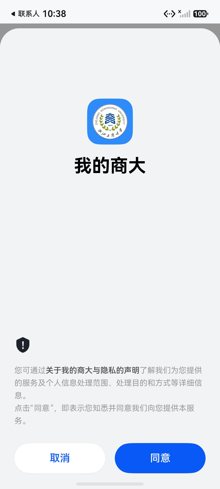 | 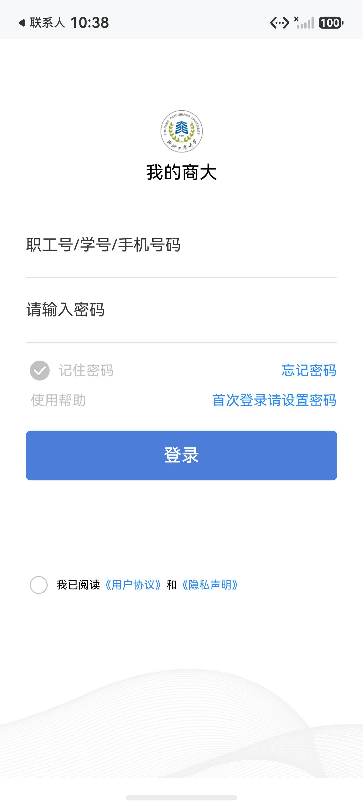 | 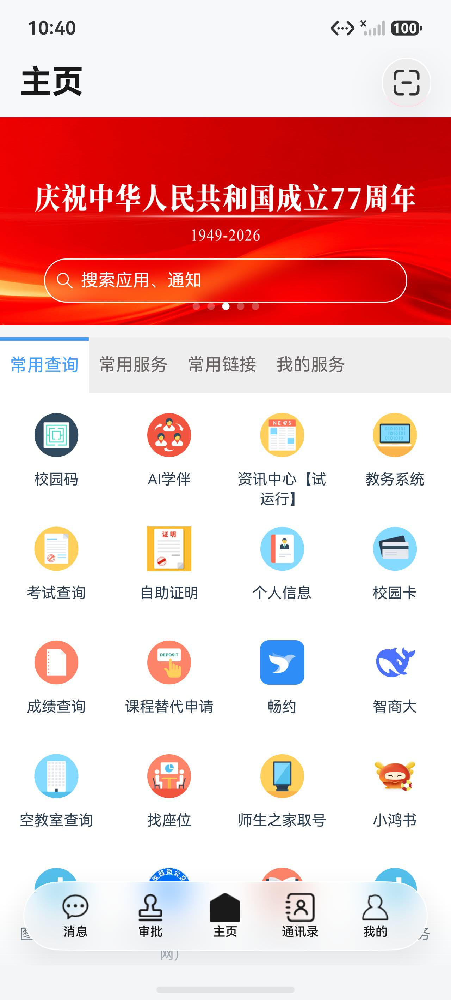 |

| 资讯中心 | 消息 | 审批 |
| :---: | :---: | :---: |
| 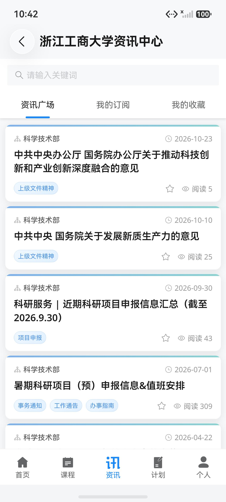 | 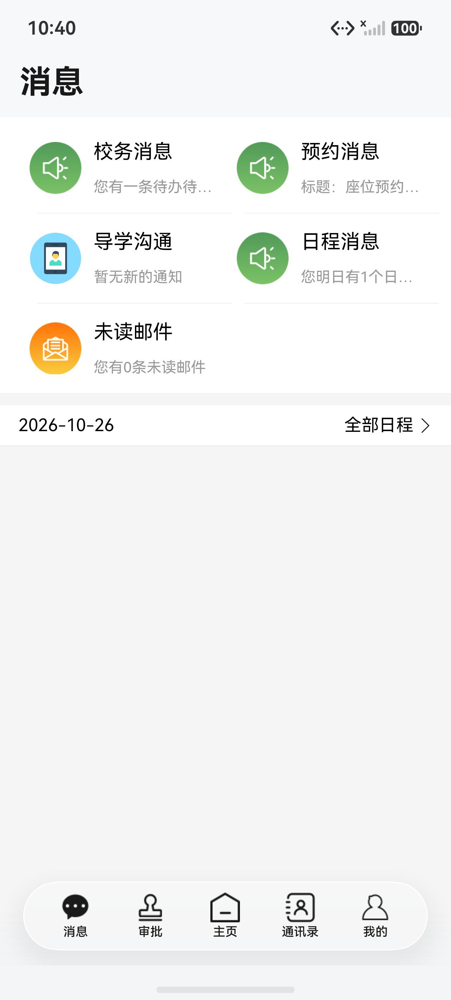 | 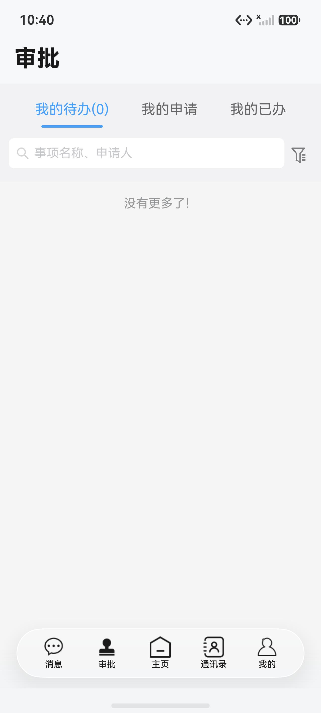 |

| 通讯录 | 我的 | 设置 |
| :---: | :---: | :---: |
| 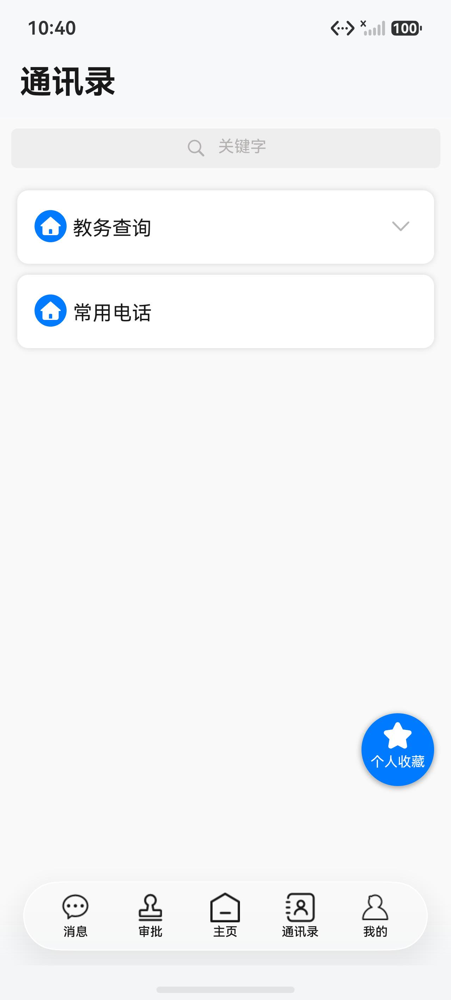 | 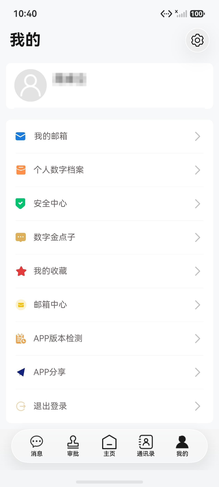 | 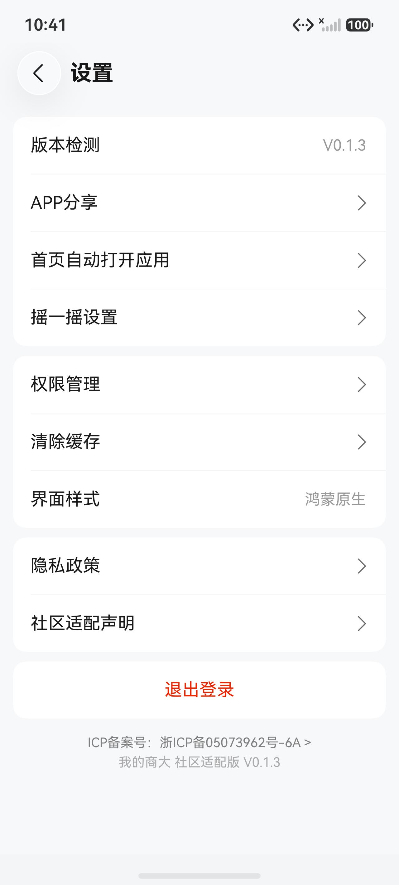 |

| 关于与隐私说明 |
| :---: |
| 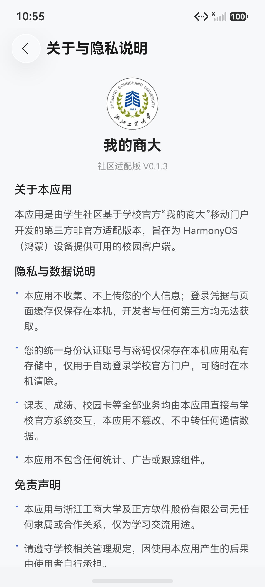 |

## 宣传图

4:3 宣传图位于 [`docs/promo`](docs/promo)，可直接用于社区分享。

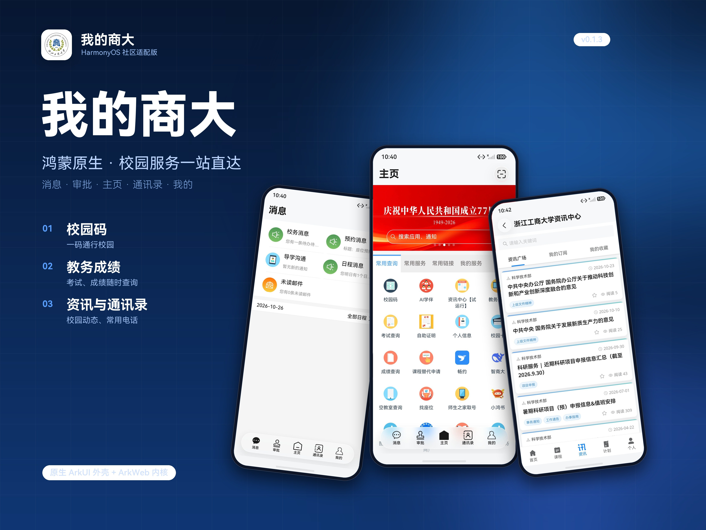

| 功能总览 | 离线能力 | 隐私说明 |
| :---: | :---: | :---: |
| 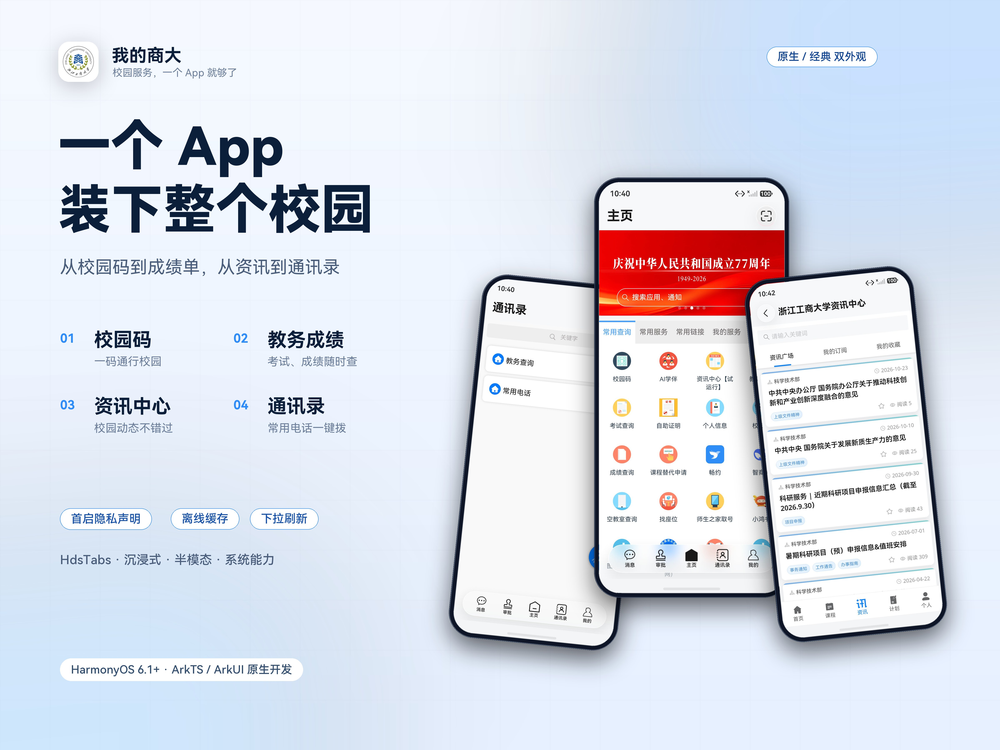 | 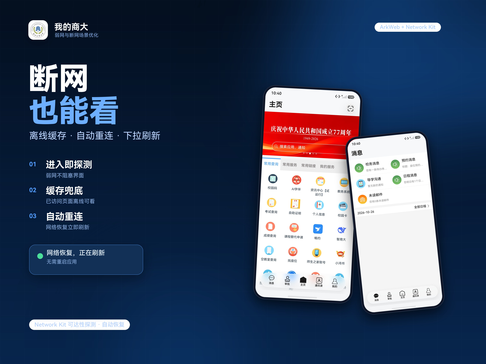 | 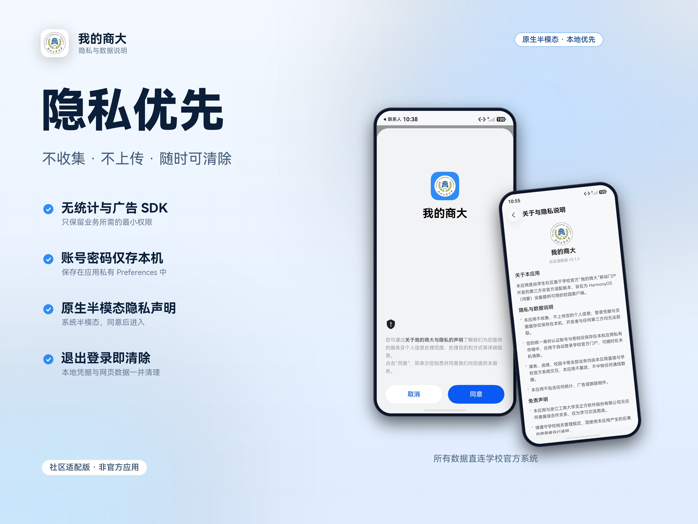 |

| 鸿蒙原生适配 | 原生 / 经典双外观 |
| :---: | :---: |
| 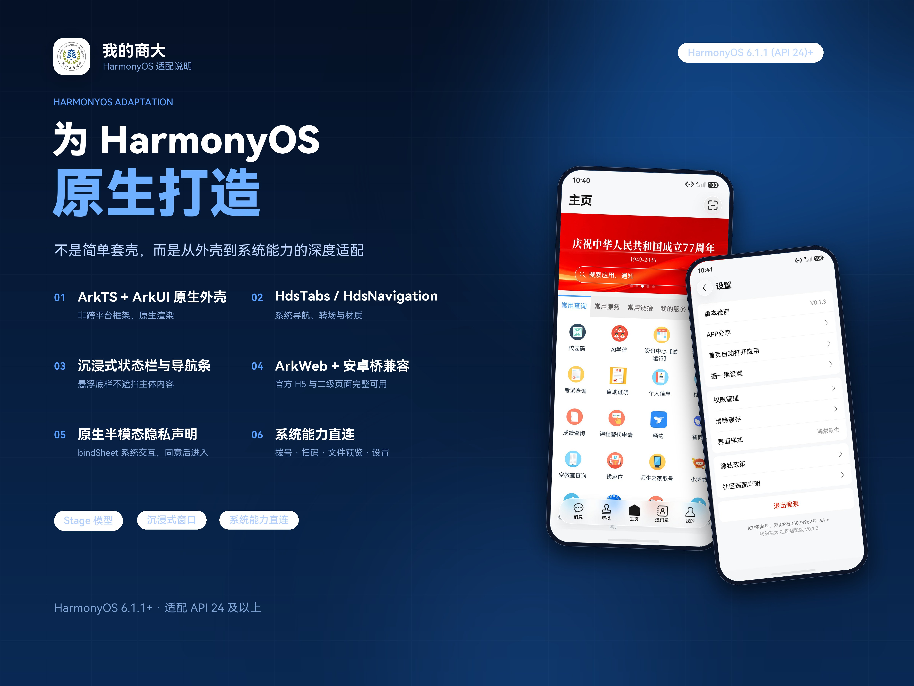 | 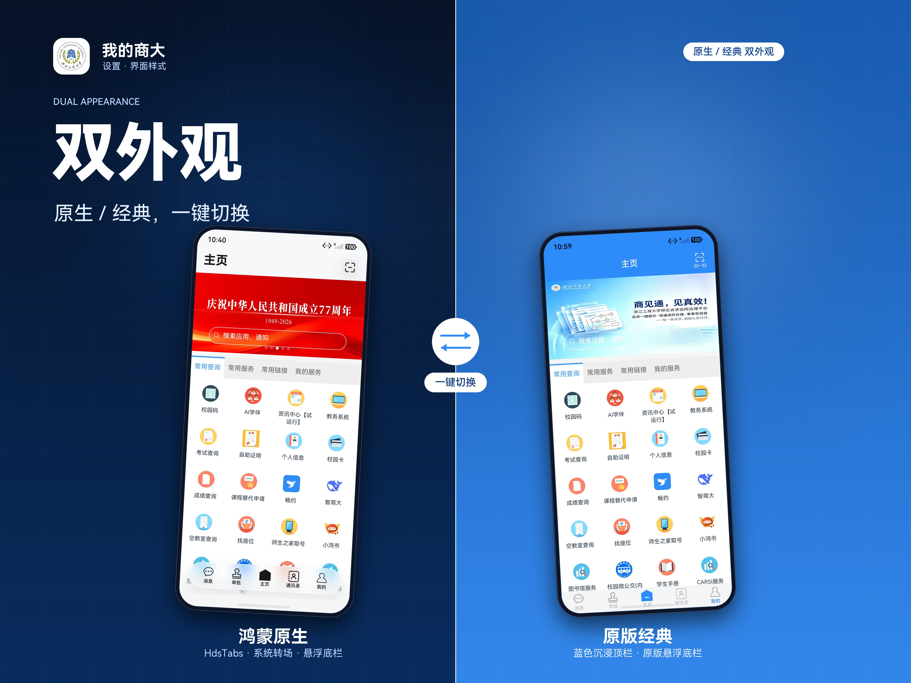 |

## 应用特色

### 原生外壳，网页内核

- 底部导航：消息、审批、主页、通讯录、我的，对应门户的五个主入口。
- 首页、审批、消息、我的提供原生骨架，业务列表仍由官方 H5 渲染，保证信息与学校系统实时一致。
- 子页面使用 `NavDestination` 独立承载，支持标题栏、返回手势与深链打开。

### 双外观样式

设置中可切换「鸿蒙原生」与「经典」两套外壳：

- **鸿蒙原生**：使用 `HdsTabs` / `HdsNavigation`，配合系统材质与悬浮底栏，状态栏与底部小白条沉浸显示。
- **经典**：保留原版 App 的顶部渐变标题栏与方形图标风格。

切换后主页、子页面、设置页会同步应用对应外壳。

### 快速登录与自动登录

- 首次启动直接使用原生登录页，校验通过后再进入门户，避免网页登录页反复跳转。
- 支持「记住密码」，凭据保存在应用私有 Preferences 中，仅用于向学校统一身份认证提交。
- 门户 H5 需要登录态时，注入脚本会等待 RSA 公钥就绪并检测验证码状态，满足条件后自动提交，否则回退到网页登录页。
- 设置页提供「退出登录」，可清除本地保存的凭据与网页数据。

### 离线优先与自动重连

- 启动与切换 Tab 时先探测网络，弱网或断网立即进入离线缓存模式，不阻塞界面。
- 注入 `fetch` / `XMLHttpRequest` 缓存层，将成功响应写入本地缓存，断网时由缓存兜底。
- 页面顶部显示离线提示条，点击即可重连；网络恢复后自动重新加载在线页面，无需重启应用。
- 页面长时间无响应时展示重试界面并提供下拉刷新。

### 移动端能力补齐

- 通讯录、教务查询中的电话号码可直接拉起系统拨号盘。
- 权限管理可跳转到系统应用详情页，便于手动授予权限。
- 支持文件下载、系统文件预览、扫码、摇一摇打开校园码。
- 兼容 zfsoft 门户与通讯录 H5 的 Android 桥，补充二级页面、分享、版本检测等能力。

### 课表桌面卡片

- 三种尺寸：1×2 只看「此刻」，2×2 看今天剩余课程，2×4 带时间地点与剩余节数。
- 数据来自门户首页课表，加载完成后静默抓取落盘，断网时卡片仍可显示最后一次结果。
- 点击卡片直接回到 App 的主页。
- 配套的「上课提醒」在未来三天按课表提前 10 分钟提醒，重新抓取课表时自动重排。

### 隐私友好

- 首次启动展示系统半模态隐私声明，用户同意后才进入应用。
- 不接入统计、广告或第三方 SDK，不上传任何业务数据。
- 所有账号、密码与缓存均保存在设备本地，可在设置中清除。

## 更新说明

### 0.2.30 — 2026-11-04

**问题**：杀完后台立马点「我的」，还能看到「推荐软件」和「退出登录」。

0.2.28 那版做得不够，两个原因：

1. **「推荐软件」根本没在名单里。** 那一版只认「退出登录」「APP分享」几个字，而这两个词是猜的。
   实际这个页里还有个「推荐软件」区块（推广别的 App），从来没被处理过。
2. **注入太晚。** 脚本挂在 `onPageEnd`，而且只扫 4 秒（10 轮 × 400ms）就收工。杀后台走的是缓存
   恢复，`onPageEnd` 可能很早就来过、也可能来得比按钮渲染还早；等你「立马点」进去时，
   扫描窗口已经关了，按钮这才慢悠悠地长出来 —— 自然看不见。

**改法**：

- **挪到 `javaScriptOnDocumentStart` 注入**（`WebTab` 里本来就在用它给门户塞桥脚本）。
  这是文档开始解析时就执行的点位，不受缓存恢复影响；`MutationObserver` 改成常驻不再停，
  节点一插进 DOM 的那一下就会被标记。`onPageEnd` 的注入保留，作为 SPA 内部导航的补扫。
- **两类目标分开处理**：
  - `row` —— 单独一行（退出登录这类按钮），往上找「这一行除了它没别的文案」的容器一并藏。
  - `block` —— 带内容的区块（推荐软件 = 标题 + 一串 App），判据正好相反：**标题的同级里
    还有带文字的兄弟**，说明它是区块标题，连标题带列表一起藏。只藏标题会留下一截孤零零的图标。
- **两道保险防止吞掉整页**：闸一是兄弟节点数 ≤ 8（超过说明这不是「标题 + 内容」，
  而是页面根容器把东西平铺在一起），闸二是容器内文案 ≤ 40 条。真判不出来时宁可只藏标题。
- **内置诊断**：第一次在 `/my` 页跑起来 1.5 秒后，把页面上「看着能点」的文字打到 console，
  `WebTab` 的 `onConsole` 会转到 hilog（tag `WebTabJS`）。以后学校换文案导致又露出来了，
  看这条 `[dsh-mine]` 日志就知道它现在叫什么，不用再猜一轮。

**自检抓到过一个真 bug**：重写脚本时漏掉了首次 `sweep()`。document-start 那次扫描通常是空转
（body 还没长出来），但缓存恢复、页面已渲染完才补注入的场景全靠它，漏了就等于白跑。
`.tools/test_hide_mine_js.mjs` 现在 18 项断言，包含「区块要整块藏」和「不许吞整页」两条关键用例。

> **真机验证：待补。** 设备离线。装上后：杀后台 → 立刻点「我的」，看这三样还在不在。
> 若还在，抓一下 hilog 里的 `[dsh-mine]` 那条日志发我，照着它改文案就行。
> 回退：`历史版本\我的商大-0.2.29-signed.hap`。

### 0.2.29 — 2026-11-04

**清理**：删掉四个从没被引用过的原生页面。

`pages/` 下的 `NativeHomePage`、`NativeMinePage`、`NativeApprovalPage`、`NativeMsgPage`
是早期「自己画一套原生界面」的产物。后来改成四个 tab 全部直接加载学校网页，
这四个 struct 就没人 import 了（也不在 `main_pages.json` 里，`subPageBuilder` 也不认识它们），
一直躺在仓库里。留着最大的坏处不是占地方 —— 是**看代码的人会以为其中某个正在用**，
排查问题时照着它推因，方向从第一步就是错的（0.2.27 的分析就栽在这上面）。

删除前确认过：三个 `Native*` 之外零引用，删完 `hvigor` 一次编译通过，反证它们确实是死的。

`common/NativeApi.ets` 保留 —— `fetchTodoCount` 还在给待办角标和通知供数。
另外三个方法（`fetchBasicInfo` / `fetchCarousel` / `fetchServices`）随着页面一起没人调了，
但没删：它们是对学校三个接口的封装，将来若把某个 tab 改成原生视图可以直接接上。
文件里加了注释说明这个现状和「哪天不要了连同哪些类型一起删」。

**行为零变化**，这一版只是让仓库干净一点。

### 0.2.28 — 2026-11-04

**问题**：「我的」页底部的「退出登录」和「APP分享」，和设置页里的两处重复了。

先厘清这两个入口的来历 —— 它们**不是 ArkTS 画的**，是门户 H5 自己渲染的按钮，
原版 App 用的是同一个网页，所以原版必然也有。我们这边只接住了点击之后的事：

| 入口 | 网页点了以后 | 设置页里的对应项 |
|---|---|---|
| 退出登录 | 走桥 `exitLogin/logout` → `Session.confirmAndClear()` | 设置页底部红色按钮，**同一个函数** |
| APP分享 | `Router.openExternal(OFFICIAL_APK_URL)` | 「APP分享」二级页：官方版 + 社区版 |

也就是说网页那份退出登录和设置页那份**完全等价**，纯冗余；而网页那份分享更糟 ——
`OFFICIAL_APK_URL` 是 zfsoft 的**安卓 APK** 下载页，鸿蒙上下下来也装不上，属于误导。

**改法**：加一段注入脚本 `HIDE_MINE_EXTRA_JS`，在门户页面加载完后把这两个入口藏掉。

- **不认 id / class，只认文案**：学校改版换 class 很常见，换文案不常见。比对前去掉所有空白，
  兼容「APP 分享」「退出登陆」。识别「退出登录 / 退出登陆 / 退出 / APP分享 / 分享APP」。
- **连整行一起藏**：只隐藏文字会留下一条空行。脚本从文字元素往上爬，条件是「这一行里除了
  这几个按钮没有别的文案」，抓大了就退回来只藏文字本身。字体图标（`&#xe600;` 这类私有区字符）
  不算文案，否则 `&lt;i class="icon"&gt;&lt;/i&gt;退出登录` 这种最常见的写法会爬不上去。
- **只在 `/my` 路径生效**，其它页面立刻 return。
- **最坏结果只是没生效**：整段包在 `try` 里，匹配不到就什么都不做，不会把页面弄坏。

配套自检 `.tools/test_hide_mine_js.mjs`：把脚本从 TS 里取出来，在迷你 DOM 上跑 11 项断言
（同卡两项、卡里有别项、带字体图标、非目标页、带空格文案、非 /my 路径），全过。

> **真机验证：待补。** 设备离线。这一版改的是「按文案匹配学校网页的 DOM」，
> 没上机之前不能确定文案对得上 —— 如果装上后这两个入口还在，说明学校用了别的写法，
> 需要抓一次页面结构再补文案（脚本本身不会报错，也不会影响页面）。
> 回退：`历史版本\我的商大-0.2.27-signed.hap`。

### 0.2.27 — 2026-11-04

**问题**：点首页那个「搜索应用、通知」的搜索框，页面会一层接一层地往右推，停不下来。

**成因**：首页那个「搜索应用、通知」是门户 H5 自己画的，点击后是网页内部导航到
`…/home/search`，触发 `WebTab` 的桥回调进来 —— `Router.openSub` 背后是
`NavPathStack.pushPathByName`，一个没有上限的栈。而同时还有第二条路在动：
`Index.onRouteEvent` 只要看到「非根 URL + 栈为空 + 不在处理中」，就会**再**开一个子页，
并且把当前 tab 重新 `loadUrl` 拉回根地址。于是出现闭环：

```
点搜索框 → 网页跳到非根地址 → onRouteEvent 压一层子页 → tab 被拉回根页（重新加载）
        → 页面加载完又把顶层地址改成非根 → onRouteEvent 再开子页 → …
```

两条路各自都能触发，彼此又互相喂，`stack.size()` 一路涨，用户看到的就是无限跳转。

**改法**：不猜哪一条是主因，两条都掐掉，再加一道硬闸。

- `common/Nav.ets` — `Router` 记住最近一次压栈的地址与时间：**同一地址 1.2 秒内再次请求直接丢弃**；
  另外 `stack.size() >= 6` 时不再压栈，给一句「页面层级太深，请返回后再试」。
  时间戳挡不住「A 开 B、B 又开 A」这种交替循环，层数总能挡住。
- `pages/Index.ets` — `onRouteEvent` 那条自动开子页的路，**同一地址 5 秒内只开一次**。
  这一条针对的正是上面那个「开子页 → 拉回根页 → 又跳过去」的自循环。

> **真机验证：待补。** 设备离线，这是连续第五个未装机验证的版本。
> 装包后重点看两件事：① 点首页搜索框只进一次搜索页，返回后停在该停在的地方；
> ② 正常点链接进子页、返回、再点同一个链接，不能被误挡（这是这两道去重最大的副作用风险）。
> 若行为异常，`历史版本\我的商大-0.2.26-signed.hap` 可直接回退。

### 0.2.26 — 2026-11-04

**问题**：0.2.25 给登录页开了自动填充，但用户改了密码后，密码保险箱里的旧密码并不会更新，
反过来还会把旧密码填进登录框。查官方文档得到两条关键信息：

> 页面跳转时触发保存功能……密码保险箱中已存在同应用下相同账号时，则弹出**密码更新**提示框。
> （FAQ）问：登录成功后并未触发密码保险箱特性，是否必须使用 router？**答：当前没有主动触发保存的方案。**

也就是说保险箱**不是主动比对**，它只在页面跳转那一刻去读用户名、密码两个输入框。
而我们的登录成功是同一个页面里把登录界面换成主界面（`needGate = false`），一次跳转都没有 ——
系统根本没等到那个时机，于是既不保存也不更新。

**改法**：把原本的 `struct Index` 抽成 `export struct MainShell`，新增 `pages/Main` 与
`pages/Index` 两个路由页面，二者都只渲染 `MainShell`。登录成功后 `navigateAfterLogin()`
在两者之间 `router.replaceUrl` —— 界面完全一样、用户无感、栈深度仍是 1，但系统看见了一次真实跳转。
之所以来回换而不是固定跳一个，是因为同 URL 的 `replaceUrl` 不一定被算作跳转。

配套：

- 换页失败（`replaceUrl` 抛错或 1.5 秒没走）时退回原来的原地切换，绝不把人卡在登录页。
- `aboutToDisappear` 补 `sensor.off(ACCELEROMETER)`。换页会销毁旧实例，监听不摘会一次摇动触发两遍。
- `main_pages.json` 增加 `pages/Main`。

> **真机验证：待补。** 这是本轮唯一改到页面结构的版本，出包时设备离线未能装机。
> 装包后重点看三件事：① 登录成功后能正常进主页（不会白屏/卡住）；
> ② 登录成功时系统弹出「保存密码 / 更新密码」；③ 杀后台再进仍能自动登录。
> 若出现异常，`历史版本\我的商大-0.2.25-signed.hap` 可直接回退。

### 0.2.25 — 2026-11-04

**一、冷启动与重新登录都固定落在主页。** 0.2.19 加的「恢复上次停留的 tab」去掉了 —— 实际用起来
很割裂：杀后台再进来，人还停在「我的」或「通讯录」，标题栏和内容都不是自己刚点出来的那一下，
像是应用没退干净。现在 `aboutToAppear` 直接把 `currentTab` 置为 `HOME_TAB`，
`PrefsStore` 的 `saveLastTab` / `getLastTab` / `KEY_LAST_TAB` 一并删掉（旧版本留下的那个键不再有用，
留着也无害）。

**二、登录页接入系统密码保险箱。** 登录页的两个输入框打开自动填充：
`.enableAutoFill(true)` + `.contentType(ContentType.USER_NAME / PASSWORD)`。
登录提交后系统会问「是否保存到密码保险箱」，下次进登录页会自动把账号密码填回来。
眼睛图标只是把内容显示成明文，`contentType` 仍是 `PASSWORD`，保险箱照样认得。

> 为什么只开这一处：0.2.21 曾把主 Web 的自动填充关掉，因为自动登录每次冷启动都会替用户
> 提交一次带密码的表单，系统把它当成用户主动登录，于是每次进来都弹「是否更新密码」。
> 那是噪音，该关；登录页这个是人手动输、手动点的地方，该开。**主 Web 与校验用的隐藏 Web
> 继续保持 `enableAutoFill(false)`。**

两者分工：我们自己存的凭据（Asset Store）负责「静默自动登录，用户连登录页都看不到」；
系统保险箱是另一层保险 —— 万一我们的存储不可用，账号密码还能被填回来。

### 0.2.24 — 2026-11-04

真机测出来的结论很直白：勾上「记住密码」登录，提示「本机加密不可用，密码未保存」——
也就是说 **存这一步从来没成功过**。0.2.23 里那把「删掉密钥重建再试」的重试也没救回来。

回头看，0.2.21 及更早之所以「记得住」，是因为校验失败时会退回 preferences 存一份明文；
0.2.22 掐掉明文兜底之后，这个功能就整体消失了。问题不在兜底，在于加密本身就没通。

**一、账号密码改存系统的资产存储（Asset Store Kit）。** 新建 `common/CredStore.ets`，
用 `asset.add` / `asset.query` / `asset.remove` 存取一条别名资产，内容是
`{"user":"...","pass":"..."}` 的 UTF-8 字节，`ACCESSIBILITY` 取 `DEVICE_FIRST_UNLOCKED`
（设备首次解锁后可读，不同步、不上云）。密钥由系统托管，应用只拿到别名，不需要也无法导出密钥材料。

存取顺序变成：**资产存储 → 自己拼的 HUKS（保留作回退）→ 都不通就不存**。绝不写明文。
`clearLogin` 两处都清，否则「退出登录」会变成假的；`migrateLegacy` 也改成把遗留明文迁进资产存储，
迁完回读校验通过才删明文。

**二、冷启动把凭据同时放进 AppStorage。** 各 tab 的自动登录先读自己那份（`aboutToAppear` 里异步读盘），
读不到才看 `dsh_session_pass`。冷启动时页面有可能比读盘先加载完，缺这条兜底就会「明明记住了密码，
却提示未登录」。

**三、其余沿用 0.2.23**：登录失败按现场给原因（验证码 / 学校原话 / 没提交上去 / 空密码）、
提交前重新断言输入框、不再因子页面被弹回就删凭据。

> **验证要点**：登录成功时提示「登录成功，已记住账号密码」才算存下；
> 杀后台再进应直接进主页。若仍提示「密码未保存」，说明这台设备的资产存储也不可用，
> 看 `hilog -T CredStore` 里的 `asset add failed`。

### 0.2.23 — 2026-11-04

全部围绕登录这条路。起因是 0.2.22 之后冒出两个现象：同一组账号密码第一次能登、第二次却说密码错；
以及登录成功、杀掉后台再进来又要重新登录。

**一、记住密码可能根本没存下。** 凭据是 HUKS 加密后存的，写之前会解一次做往返校验。校验不通过时，
0.2.22 的做法是**直接不存** —— 安全上没错，但界面上只有一句 2.6 秒的提示，用户很容易错过，
结果就是「记住密码」静默失效。

现在改成：往返校验不通时，先 `deleteKeyItem` 把旧密钥删掉重建一把再试一次（多半是早期版本留下的
密钥跟现在的 `initSession` 参数对不上），还不行才放弃。丢掉一把解不开的密钥没有损失 —— 它对应的
密文本来也解不回来。

**二、不再因为「某个页面被弹回登录页」就删掉记住的密码。** 以前自动登录连续两轮被送回登录页，
就判定「账号或密码错误」，同时 `clearLogin` 删凭据、把人踹回登录页。但「被弹回」不等于密码错：
通讯录这类子服务有自己的 SSO 入口，它不兼容时也会被弹回，而代价是用户从此失去记住密码。

现在只有**门户首页**（`isPortalUrl(rootUrl) && scrapeSchedule`）反复失败才认定凭据失效，
阈值从 2 提到 3，并且任何情况下都不再删已保存的凭据 —— 真错了也没关系，用户重新登录一次就覆盖了。

**三、登录失败会说清原因。** 以前只要提交后被送回登录页，一律报「账号或密码错误」。但同一个 URL
底下可能是三件事：密码真错、学校要求输验证码、表单压根没提交上去。新增 `PROBE_STATE_JS` 读回
页面现场（`#errormsg` / `#msg` / 验证码是否可见 / 脚本走到哪一步 / 两个输入框还剩几个字符），
按实际情况给文案：

| 现场 | 提示 |
| --- | --- |
| 验证码可见 | 学校这次要求输入验证码：请先用手机浏览器打开统一身份认证登录一次，再回来重试 |
| 页面有错误文案 | 学校提示：<原话> |
| 该提交却没提交（`blocked`） | 登录页没准备好（没拿到加密公钥），请稍后重试 |
| 提交了但没回应 | 提交后学校没有回应，请检查网络后重试 |
| 密码框是空的 | 密码没能填进登录框，请重试 |
| 以上都不是 | 账号或密码错误，请重新输入 |

**四、提交前重新断言输入值。** 学校登录页在 ready 里有一句 `$("#ppassword").val($("#password").val())`，
`#password` 是隐藏域、新页面里是空的。只要它比我们的填充晚一步执行，刚填进去的密码就被清成空串，
提交上去等于空密码，服务器必然打回 —— 这正是「刚才还能登、这次说密码错」的机制。现在 `submit()`
每轮点击前都比对一次，不一致就重填。

**五、日志。** `saveLogin` 每个分支都写一行，`getLogin` 在「有密文却解不回来」时也写 ——
这是「记住密码突然失效」唯一能对得上号的线索。

> **真机验证：待补。** 本版出包时设备已离线（`hdc` 连不上），尚未装机复现。
> 装包后若「记住密码」仍失效，请反馈登录成功那句提示的原文（「已记住账号密码」还是
> 「本机加密不可用，密码未保存」），再配合 `hilog -T PrefsStore` 即可定位到具体分支。

### 0.2.22 — 2026-11-03

这一版没有新功能，全部是之前记在待办上的欠账：五处真缺陷、三处工程债。同时把版本号往上抬一格 ——
从这一版起一个功能批次升一次，覆盖安装才不会被判降级（`versionCode` 不递增会报 downgrade，
只能靠 `hdc install -d` 强降），出问题也能按版本回溯。

**一、凭据加密的 nonce 换了随机源。** 原来用 `Math.random()` 生成 12 字节的 GCM nonce。
它是伪随机，且同一次启动内的序列可预测；而 GCM 一旦 nonce 重复，两条密文的异或就直接泄露明文关系，
严重的能恢复出明文 —— 加密等于白做。改用 `cryptoFramework.createRandom().generateRandomSync(12)`。
顺带把 `encrypt` / `decrypt` 各自包了 try/catch 并写日志，失败不再无声无息地返回空串。

**二、加密不可用时不再退回明文存密码。** 原来 HUKS 不可用会在 `preferences` 里明文存一份，
理由是「保证记住密码这个功能不失效」。这个取舍是错的：`preferences` 是沙箱里的普通文件，能被备份、
能被三方工具读到，而这里存的是统一身份认证的密码 —— 泄露一次，教务、邮箱、一卡通跟着全失守。

- `saveLogin` 改为返回「是否真的存下了」。存不下就把四个键全清掉，一个字节的凭据都不留。
- 登录成功的提示跟着分叉：「登录成功，已记住账号密码」/「登录成功，本机加密不可用，密码未保存」
  （后者停 2.6 秒，够看清），不再一律说「已记住」。
- 老版本留下的明文凭据改走新加的 `migrateLegacy()`：能加密才迁移、往返校验通过才落盘、
  迁不动就原样留着先保住自动登录。**不能**复用 `saveLogin` —— 那条路在加密失败时会把四个键全删，
  等于在这次启动里把用户唯一的一份凭据抹了。

**三、网页要权限，只给学校自己的域名。** `onPermissionRequest` 原来是无条件
`grant(getAccessibleResource())`：页面一旦被导航到第三方站点，那边张口要摄像头、麦克风、定位，
也是一句话就拿到，用户完全不会被告知。现在按来源判断 —— 新增的 `isSchoolUrl()` 只看主机名是否为
`zjgsu.edu.cn` 或其子域（去端口后精确比较，`https://zjgsu.evil.com`、`https://evil.com/#zjgsu.edu.cn`
这类子串伎俩过不了），是才授予，否则 `deny()` 并记日志。注意 `OnPermissionRequestEvent` 本身只有
`request` 一个字段，来源得从 `request.getOrigin()` 取，`event.origin` 不存在。

**四、学校网页关掉 `file://` 访问。** `.fileAccess(true)` 原来是写死的，等于给每个加载的网页开了
读本地文件的通道，而门户根本用不到。改成 `.fileAccess(!isHttpUrl(this.rootUrl))`：只有本地 `rawfile`
页面（首次启动的隐私声明、加载失败页）需要这一项，http/https 一律关。

**五、协议勾选不再替用户预勾。** 退出登录回到登录页时 `agreeTerms` 被设成 `true`，
「我已阅读并同意《用户协议》」已经是勾好的状态，用户点一下登录就等于默认同意。这类同意必须由用户
主动做出，改成 `false`。

**六、作息表收归一处。** `PERIOD_START` 之前在三处各写一份（`Reminders.ets`、`ScheduleCardAbility.ets`、
以及解析侧隐含的节次数），改一处忘一处就会出现「提醒时间和卡片显示对不上」。现在统一到
`common/Periods.ets`：起止时间表 + `toMinutes()` / `startOf()` / `endOf()`，其余文件只 import。

**七、学期与周次真正用上。** 抓课表时 `term` 和 `week` 一直在解析、一直在落盘，界面上却从没出现过，
等于白抓。设置页「上课提醒」下面新增「当前学期」一行，显示周次简称（如「第八周」），点一下 toast
出完整区间。没有课表缓存时整行不出现，不留一个空壳。

**八、补了 18 个业务单测。** 之前 `entry/src/test/` 只有一个模板用例（断言 `1+1=2`），跑绿等于没测。
现在三个 suite、18 个用例，都咬着纯函数：

| suite | 用例数 | 覆盖 |
| --- | :---: | --- |
| `parseSchedule` | 6 | 空串 / 非 JSON 不抛异常 / 还原 `runJavaScript` 外层引号与转义 / `courses` 缺失 / 无课名条目丢弃 / 缺省字段兜底 |
| `periods` | 6 | 起止表长度一致 / `toMinutes` 换算与坏输入 / `startOf` 越界 / `endOf` 跨节与越界 |
| `reminderPlan` | 6 | 同格只留第一门 / 先星期后节次排序 / 指纹同内容同值、换教室即变、与顺序无关 / 节次越界不计入可发条数 |

`reminderPlan` 那组是给提醒服务的：去重和排序决定了「撞 30 条上限时先截掉哪一段」，排序错了被截掉的
会是周一。`hvigor test` 三套全绿。

**九、真机验证。** 覆盖安装后冷启动直接进「我的」，自动登录正常、无需重新输密码；设置页版本显示
`V0.2.22`，「当前学期」显示 `第八周`，点开提示 `2026-2027 第一学期 · 第八周 (2026-11-02 ~ 2026-11-06)`。
权限授予与 `fileAccess` 这两处是收紧策略，本机只复测了门户页加载与登录流程正常 ——
扫码、定位、附件下载这几条依赖权限或本地文件的能力**没有逐一复测**，留待下次回归一起过。

### 0.2.21 — 2026-10-28

- **登录页密码框右侧的眼睛常显**。之前只有输入过密码才出现，空框时右边什么都没有，看着像没这个功能。
  现在一直显示，空密码时淡到 35% 当占位，输进去后恢复正常不透明度；点击热区从 16vp 图放大到 44×44，
  不用瞄着点。点一下明文、再点一下回合圆点，图标跟着在「睁眼 / 闭眼」之间切换。
- **门户页的图标、列表项按下有反馈了**。原来是点下去毫无动静，有没有点中只能靠猜。
  现在往网页里注入一段事件委托脚本：`touchstart` 时给被按住的那个元素加 `dsh-press-scale`
  （`scale(.94)` + 透明度 0.78），`touchend` 之后 70ms 撤掉；滚动、切换页面时也会立即撤销，不会留下按下的残影。
  - 只动 `transform` 和 `opacity`，这两者都不参与布局，不会把页面顶歪。
  - 元素自己带 `transform`（靠位移定位的那种）时退化成只变透明度，免得把它挪回原位。
  - 命中判断按 `A` / `BUTTON` / `role=button` / `cursor:pointer` 向上找最近的可点元素，最多找 6 层。
- **加载失败页说人话了**。以前不管什么原因都只说「本地没有可用离线缓存」，看到的人只会以为缓存坏了，
  实际上多半是「这个服务只对校园网开放」「服务器把连接掐了」。现在按 ArkWeb 的底层错误名翻成一句结论，
  并带上主机名，例如「连不上 xssw.zjgsu.edu.cn：这个服务可能只在校园网内开放，连上校园 WiFi 或学校 VPN 后重试」。
  - 覆盖 `CONNECTION_RESET / REFUSED / CLOSED / FAILED`、`ADDRESS_UNREACHABLE`、`TIMED_OUT`、
    `NAME_NOT_RESOLVED`、SSL/CERT 失败、`EMPTY_RESPONSE` 等。
  - HTTP 5xx 单独说清楚是「学校服务端的故障」，别再让人以为是手机的问题。
  - 真实原因会跨过「切离线缓存」这一步保留下来，不会被后面那句「没有离线缓存」盖掉；
    用户手动点重试或发起新的在线导航时才清空。
- 真机验证：师生交流 / 学生离校办理 / 留校申请（`xssw` 连接被重置）、公寓智能门锁（`hqgy` 不可达）
  两类的失败页都给出了对应文案；按住服务图标时该格整体缩到 94%（内容像素 14958→12777、宽高 248→233），
  松开即恢复；眼睛空框淡显、点击明文/掩码双向切换均正常。
- **同日修订（版本号不变）**：上游 GitHub 用户名拼写由 `ZHOUcourrier` 更正为 `ZHOUcourier`，
  原先多打了一个 `r`。双 `r` 的账号在 GitHub 上并不存在（404），单 `r` 才是原作者本人
  （`github.com/ZHOUcourier`，主页有 localquant 等公开项目）。改动落在 `Constants.ets` 的三个常量、
  各源文件头部出处注释与本 README 的署名表；`app.json5` 的 `versionName` / `versionCode` 未动。
  提交 `2aacdb7`。
- **同日修复（版本号不变）**：
  - 主网页补 `Web.enableAutoFill(false)`。自动登录每次冷启动都会把凭据填进统一认证页并提交，
    系统密码保险箱把它当成用户主动登录，于是每次都弹「是否更新密码」。登录校验那个 Web 和两个输入框
    早就关了，唯独漏了主 Web。
  - 上课提醒改为**按周重复的闹钟型**（`REMINDER_TYPE_ALARM` + `daysOfWeek`）。原来是日历型且只排未来
    3 天、只在课表内容变化时重排，课表一学期不变 → 排完第一次就再也不补，窗口一过彻底不响。
    重建判据改为「课表指纹 + 现存提醒数」。设置页新增「上课提醒」开关。
  - `requestEnableNotification` 改用带 `UIAbilityContext` 的重载。空参版本自 API 12 起废弃，
    调了既不弹授权框也不报错，通知状态便一直停在关闭。
  - 遗留：真机上系统仍以 `notification not allowed` 拒绝发布提醒。后续定位结论见本文
    「2026-11-03 提醒」一节。
- **2026-11-03 修订（版本号与 `versionCode` 均未变）**。这一轮起因是面谈前自查，
  分三次提交，`app.json5` 始终没动。

  **一、面谈前的代码体检，修掉 6 处逻辑与安全问题（提交 `1966fca`）**

  1. `Index.setupNotifications` 还留着「先问 `isNotificationEnabled`，没开才申请」+ 无参
     `requestEnableNotification`。前者在真机上会谎报已开启，后者从 API 12 起废弃、不传 ctx 根本不弹框，
     两个叠在一起等于启动路径上从来没真正申请过通知权限。改成直接带 ctx 申请。
  2. `WebTab` 自动登录拼接密码未转义：`Index` 那边一直是 `JSON.stringify(...).slice(1,-1)`，
     `WebTab` 却直接把密码塞进单引号里。密码含 `'` 或 `\` 时整段脚本语法错误，自动登录永不提交；
     这同时是一个 JS 注入点。已与 `Index` 对齐。
  3. URL 判定用子串匹配，凭据可被投递到外站：`isLoginUrl` / `isPortalUrl` / `isContactUrl` 原来是
     `url.includes('://host/path')`，像 `https://evil.com/#https://uia.zjgsu.edu.cn/cas/login` 也能命中，
     命中之后就会把学号密码注入进去自动提交。新增 `hostIs()` 按主机名精确比较（兼容端口）。
  4. 空课表会覆盖缓存，桌面卡片从此永久显示「今天没课」：判空条件原来是
     `courses.length === 0 && week.length === 0`，而放假周、开学前、以及 3.5 秒延时抓取撞上页面未渲染完时，
     都是「有周次、没课程」。改成 `courses` 为空一律不落盘，保留旧缓存。
  5. 明文兜底时没删旧密文，改了密码读出来还是旧的：`getLogin` 优先读密文，而 `saveLogin` 走明文分支时
     没 `delete` 密文键。补上两个 `delete`，让两条路径互斥。
  6. 提醒的三处健壮性：`alive > 0` 判据过弱（只要还剩一条就判定「还活着」，缺的几门永远补不回来）→
     改成 `alive >= 应发条数`；`publish` 是 fire-and-forget 且紧接着写指纹（有没回来的就先写了盘，
     下次又整批重发，撞 30 条上限后后半批全失败）→ 改成 `Promise.all` 后统一 `await`；
     `sync` 无串行化（首页 `onPageEnd` 和设置页开关可能同时进来）→ 改成 Promise 链排队。

  **二、退出登录真正把本机数据清干净（提交 `dac2985`）**

  原先 `clearAll()` 只清 Cookie、登录偏好和两个 AppStorage 键，注释还写着「不清存储，离线缓存还能用」。
  换账号后会出现数据串号：「我的」页仍是上一个人的姓名、学号、成绩、一卡通余额（来自 localStorage 里
  `__dsh_http_cache_v1__` 的接口响应缓存），桌面卡片仍是上一个人的课表，待办通知和角标还挂着，
  已排的上课提醒还按上一个人的课表响。

  现在拆成两档：

  - `clearAll()`：用户主动退出，全清 —— Cookie、`WebStorage.deleteAllData()`
    （localStorage / Web SQL / IndexedDB）、`basic.json` / `todo.json` / `schedule.json`、
    凭据、待办通知与桌面角标、`Reminders.cancelAll()`、AppStorage 状态。
  - `clearSession()`：只是会话失效（票据过期、密码输错），只清 Cookie 和凭据，离线课表与已排提醒留着，
    重新登录后卡片立刻有内容，不用再等一次抓取。

  `Index.onLoginFailed()` 改用 `clearSession()`，避免每次会话过期都把课表缓存和提醒一起清掉。
  另外 `dsh_logout_ts` 用 `now > old ? now : old + 1` 兜底（同一毫秒内两次登出也能触发 `@Watch`），
  `dsh_last_todo` 归零（否则下次抓到的条数比它小就不再推通知、不再亮角标）。

  真机验证：点「退出登录」后 `files/` 变空、prefs 里账号密码消失、界面回到登录页；
  重新登录后 `schedule.json` / `todo.json` 重新生成、凭据重新写入、冷启动自动登录正常。

  **三、提醒的三处加固，以及「到点不响」的真机结论（提交 `b939f7c`）**

  加固（都是为了少踩坑，与下面的设备问题无关）：

  - 清空提醒改用 `cancelAllReminders()`。原来只走「`getValidReminders()` 拿列表 → 逐条
    `cancelReminder`」，列表接口在个别设备上会抛错（日志 `ReminderAgentService: Read result failed,
    code is: 1`），一抛整批都删不掉，紧接着的 `publish` 就撞上限。逐条删保留作兜底。
  - `aliveCount()` 出错返回 `-1` 而不是 `0`。以前静默返回 0，读不到就当「一条都没有」，
    于是每次进 App 都判定要重建：清不掉旧的、再发一批新的、撞上限、后半批全失败。
  - 提醒请求显式指定 `slotType: SOCIAL_COMMUNICATION`，发布前调一次 `addSlot()`（幂等）；
    `requestEnableNotification` 的成功/失败都写日志并带上错误码。

  真机结论：**这台设备上提醒发布不出去，且不是代码问题**。日志两侧对照如下——

  ```
  应用侧：sync: courses=17 expect=17 alive=0 → cancelAllReminders ok → slot ready
          → notification granted → republish 17 of 17 → publish failed（17 次）
  系统侧：ReminderControl com.humour.myshangda, notification not allowed.
          ANS_REMINDER: The number of reminders exceeds the limit[0].
  ```

  那个 `limit[0]` 是关键：不是 30 条上限打满，而是系统把该应用的提醒配额算成了 **0 条**，起因是
  `notification not allowed`。而同一时刻：系统设置里「允许通知」是开着的、`isNotificationEnabled()`、
  `requestEnableNotification()`、`addSlot()` 全部返回成功 —— 三方状态互相矛盾，属系统侧记录异常。
  卸载重装、在授权弹窗点「允许」、把设置里的开关关掉再打开，都试过，仍判否。
  换设备或重置系统通知状态后应可恢复。`bm dump` 里的 `allowEnableNotification` 字段与真实状态无关
  （重装前后、点允许/不允许之后都是 `false`），不要拿它判断。


### 0.2.20 — 2026-10-28

- **点「登录」先验账号密码，验不过就留在登录页**。以前只要点按钮就直接进门户，账号或密码错了照样跳过去，
  然后停在永远加载不出来的主界面上：没有报错，也没有退路。现在按钮下方会先出现「正在验证账号密码，请稍候…」，
  校验通过才放行；失败则红字写清原因（账号或密码错误 / 登录超时 / 连不上统一身份认证），密码框清空，人留在登录页。
- **校验方式沿用了真实登录流程**，而不是在 ArkTS 里复刻 CAS 协议。这套登录页的密码要先用页面下发的 RSA 公钥
  加密（`v2/getPubKey`），还可能弹验证码，自己重写既容易错、也扛不住学校改版。所以让一个**被背景图完全盖住
  的 Web** 在背后把登录跑一遍，判定标准只有一条：提交后能不能离开 `uia.zjgsu.edu.cn/cas/login`。
  - 这个 Web 必须留在可视区内（只是被遮住）：Chromium 会把移出屏幕的页面当成不可见，节流掉它的定时器，
    登录脚本就永远不跑。`position x: -720` 那版实测日志一条都没有。
  - 校验前先 `clearAllCookiesSync()` 清掉本机残留的 CAS 会话。不清的话页面一进去就 302 放行，
    输错的密码照样能过 —— 第一版就是这么假通过的。
- **账号密码只在验证通过后才落盘**。勾了「记住密码」也不会提前写入，校验失败时还会顺手清掉旧凭据，
  避免下次拿旧密码直接进门户。
- **系统密码保险箱不再在点按钮时弹出来**：登录页两个输入框关掉自动填充（`enableAutoFill(false)`），
  保存提示改到校验通过之后，文案是「登录成功，已记住账号密码」。
  背后的校验 Web 也要单独关掉自动填充 —— 它会真的提交一次带密码框的表单，不关的话系统会把这次提交
  当成用户主动登录，弹出「是否保存账号和密码？」把整页盖住。
- **门户侧判定凭据失效时也会退回登录页**：自动登录连跑两轮还停在统一身份认证页，即视为凭据无效，
  清会话、清凭据、密码框清空，红字说明原因。会话用久了自然过期同样走这条路，比留个白屏合理。
- 登录按钮下方的提示用**固定高度占位**，出现红字时不会把「我已阅读《用户协议》」那行顶走位
  （那一行的间距是照着原版背景图对过的）。
- **顺带补上设置页退出登录的二次确认**：这一处以前点一下就执行，误触会直接清掉网页会话与本机凭据，
  和其他入口不一致；现在统一走 `Session.confirmAndClear()`，选「取消」不做任何改动。
- 真机验证：错误凭据（`testuser123` / `wrongpass`）1~2 秒内回到登录页并显示红字，全程无密码保险箱弹窗；
  正确凭据同样 1~2 秒通过，直接进门户并提示「登录成功，已记住账号密码」；冷启动自动登录正常。

### 0.2.19 — 2026-10-28

- **修好「快速滑动收起底栏」在真机上完全失效**。`WebTab` 的触摸采样把 `TouchType.Down` 当作起点，
  但 `Web` 是原生组件，ArkUI 层的 `onTouch` 实际只收到 `Move` 与 `Up`（实测一轮快速上滑：132 次 Move、
  1 次 Up、0 次 Down）。起点 `touchY` 因此恒为 -1，所有 `Move` 在第一个判断就被丢弃，手势永远不生效。
  现在改成「没有基线就拿当前 `Move` 点当基线」，不依赖 `Down` 也能测出速度。
- 验证：上滑后 `barBottomMargin` 由 6 变 -180、底栏整条移出屏幕；停止上滑 1.5 秒自动回来；下滑立即唤出；
  原版 App 样式下照旧常驻不收起。
- 全功能回归同时覆盖：五 Tab 切换与冷启动恢复、双外观切换与重启保持、下拉刷新（含 3 秒节流）、
  学生手册死链纠正、PDF 附件下载与预览、页面跳转返回、扫码、拨号、设置页全部入口、
  社区适配页四个链接、桌面课表卡。

### 0.2.18 — 2026-10-27

- **包名改为 `com.humour.myshangda`**，与原作者仓库的 `com.courier.myshangda` 分开。原因是后者在本机
  没有任何签名材料，只能产出 unsigned 包、还得在 DevEco 里手工签名才能装；换成自己账号下的包名后，
  可以直接用调试证书签名，`hap-sign-tool verify-app` 校验通过，出包即可安装。
- `vendor` 同步改为 `humour213`。
- **上课提醒的跳转包名同步修改**（`Reminders.ets` 的 `PKG_NAME`）。这个常量必须与工程一致，
  漏改会导致点击提醒拉不起应用。
- 已经装过 0.2.17 的设备可**直接覆盖升级**，包名未变，登录态、偏好设置与课表缓存都保留。
- 签名用的是 AGC 调试证书（`com.humour.myshangda`，有效期至 2027-10-21），**绑定 3 台已登记设备**，
  只能在这些设备上安装，不用于公开分发；对外发布仍需申请正式发布证书。

### 0.2.17 — 2026-10-27

- **原版样式的底栏回到「占满整行的一条」，不做胶囊**：0.2.16 用 `barOverlap` + 浮动样式把它变成了
  悬浮药丸，观感跑偏，已撤回。现在仍是 `Tabs` 底部留 24vp（`CLASSIC_BAR_LIFT`）+ 底栏同色填充
  （`CLASSIC_BAR_BG`），底栏高度、图标、配色与安卓 / iOS 端一致，也不会被手势条压住。
- **原生样式真的沉浸了**：`HdsNavigation` 的 `expandSafeArea` 补上 `SafeAreaEdge.BOTTOM`
  （原来只有 TOP）。内容不再止步于安全区上沿，而是一直铺到屏幕最下沿、从「沉浸光感」底栏后面穿过，
  底栏下方不再是一条窗口白底。
- 保留 0.2.15 的其余改动：原生样式下边距 6vp、原版样式底栏不滑动收起、选中态文字与图标同源翻转。

### 0.2.16 — 已回滚（2026-10-27）

- ~~原版样式底栏改成浮层沉浸~~：改动方向对，但观感变成「悬浮胶囊」，与原版不一致，0.2.17 已撤回。
- **保留的结论**：`barFloatingStyle` 的 `barWidth` 只接受具体数值（文档写明 cannot be set in
  percentage），传 `'72%'` 会让整个浮动样式被忽略、`barBottomMargin` 一并失效——这是之前
  12 / 24 / 90 三个值怎么调都没反应的真正原因，以后要动浮层必须传数值。

### 0.2.15 — 2026-10-27

- **原版 App 样式底栏整体抬高**：该样式跑在真全屏沉浸里，窗口不替底栏避让系统手势条，
  底栏会一直贴到屏幕最下沿、下沿被手势条压住。现在给 `Tabs` 留 24vp 底部内边距
  （`CLASSIC_BAR_LIFT`），整条底栏连背景一起上移；底栏自身的高度、图标、配色都不动。
  抬高后露出的那一段用与底栏相同的底色（`CLASSIC_BAR_BG`）填上，底栏与底部之间不再有白条。
- **鸿蒙原生样式的底栏压低一点**：该样式由系统布局、窗口已避让过导航条，12vp 偏高，
  改成 6vp（`BAR_MARGIN_NATIVE`），更贴底但仍不会被手势条压住。
- **原版样式的底栏不再滑动收起**：这个样式的底栏是常驻的，网页里快速上滑 / 下滑
  不再收起或唤出它（原生样式仍保留该交互）。
- **修「文字变蓝比图标慢一拍」**：`Tabs` 内部的选中态在切换动画开始时就会翻转，而图标依赖
  `onChange` 里的 `currentTab`，两者不同源。现在把 `labelStyle` 的 `selectedColor` /
  `unselectedColor` 都交给 `labelColorOf(idx, ...)`，文字与图标同由 `currentTab` 驱动，一起翻转。

### 0.2.14 — 已回滚（2026-10-27）

- ~~「原版 App 样式」的浮层底栏抬高避让导航条~~：真机观感反而偏离安卓/iOS 端，已整条撤销，
  底栏离底距离回到 0.2.13 的 12vp（收起时 -180vp），`EntryAbility` 里的避让区读取一并移除。
- **保留**：社区适配页填上维护者邮箱（`2496548066@qq.com`），点一下直接发信。

### 0.2.13 — 2026-10-27

本版集中在**课表桌面卡片**与**下拉刷新**两块，中间若干次真机试装的迭代合并进这一条。

- **课表卡片改版（新版三种）**：整卡用状态色浅调打底，唯一一张白卡承载「此刻」——
  上课中就显示正在上的这门，没课就显示下一节，今天上完就显示明天第一节。白卡下方只剩
  圆点 + 课名 + 时间，退为次要信息。今天课全上完后整卡切成淡靛蓝的明天预告。
- **旧版列表卡回归（2×2 / 2×4）**：白底 + 彩色块的原版式保留，与新卡并存，长按桌面卡片
  即可二选一。按时间顺序列出还没上完的课，上完一节少一条。
- **卡片只报事实、不下结论**：去掉「上课中 / 下节」这类标签，单纯按时间列课。
- **卡片留白与弧度**：底部留白与左右等宽，滚动区按「外弧半径 − 留白」取内弧，
  两条弧同心平行，内容是弧线裁切而不是被直线切断。
- **课名尽量一行**：卡片不支持官方字号自适应，改为按文字宽度估算字号，
  在 17→12 / 20→14 / 15→12 区间里取能一行放下的最大值。
- **卡片跟着下课时间刷新**：在下课那一刻单独排一次刷新（`setFormNextRefreshTime`），
  不必等系统下次轮询。
- **下拉刷新不再顶出大片空白**：真正的原因是 ArkWeb 的 `overScrollMode` 在活动 Tab 上被开成
  `ALWAYS`，网页滚到顶部会先吃掉手势自己做回弹，再叠加原生刷新位移，两段合起来能撑到半屏。
  改为恒 `NEVER` 后，顶部白区从 237vp 降到 75vp。
- **下拉手感三参数定稿**：触发阈值 64vp、跟手比 0.55（约拉 116vp 才触发）、
  拉伸上限 88vp（怎么甩都撑不开）。

### 0.2.3 — 2026-10-27

- **恢复上次停留的 Tab**：正常退出后再打开，会回到你上次看的那一屏（此前固定落主页）。
  退出登录时不保留现场，重新登录仍落主页。
- **滑动收起底栏**：在网页里快速上滑（往下看内容）时底栏滑出屏幕，1.5 秒后自动回来；
  快速下滑随时唤出。判定用的是**滑动速度**（0.6 vp/ms）而不是距离，
  慢慢拖、微调位置都不会误触发。只改 `barFloatingStyle` 的 `barBottomMargin`，
  底栏是浮层，收起不会让网页重新排版、也不会跳动。
- 切换 Tab、切换外观、退出登录都会立即把底栏展开。

### 0.2.2 — 2026-10-26

- **底栏图标重绘**：原图标只有 40×40 px，而底栏按 24vp 渲染，3x 屏需要 72px，
  等于把 40px 放大约 1.8 倍，必然发虚。现已按 24×24 设计网格重新绘制，输出 96×96 px，
  任意分辨率下都是原生清晰度。
- **修复通讯录选中态无效**：`tab_contact_on/off` 两张图**形状完全相同**（只有颜色差别），
  而原生样式的底栏把选中/未选中统一染成近黑，于是按下没有任何变化。现在和其他 Tab 一致，
  选中为实心、未选中为线框。
- **底栏未选中项转为中灰**（图标 + 文字同步），选中项保持近黑，交互反馈更明确。
- **课表卡片改版「明天」**：今天课上完后不再把明天的课塞进今天的列表，而是整张卡切到明天预告——
  背景换成淡靛蓝，列表上方用一枚「明天 · 共 N 节」标签引领，明天的课统一用同一套靛蓝色块，
  与「今天还剩几节」在视觉上彻底分开。
- 今天整天没课时，卡片同样给出明天的第一节和明天的课表，比一句「今天没有课」更有用。

### 0.2.1 — 2026-10-26

- **下拉刷新不再一碰就刷**：触发距离从默认 64vp 提到 112vp，并加大跟手阻尼；
  首屏加载中、以及 3 秒内的连续下拉都会被忽略，避免把正在加载的页面刷坏。
- **附件入口再补一层**：地址里带 `?file=` 的预览器页面会先把真实文件地址解出来；
  下载接口没有后缀时按服务器返回的 Content-Type 补扩展名；文件名里的非法字符自动替换，
  否则写盘会直接失败。
- **修复 `resource://rawfile/` 被路由丢弃**：`file:///android_asset/` 映射过来的本地页
  之前点开毫无反应，现在能正常进子页；不支持的地址会给提示而不是静默失败。
- **兜底页多了「在浏览器打开」**：套壳确实兼容不了的页面不必反复点重试。
- **桥接新增** `openByBrowser` / `openBrowser` / `viewFile` / `getFile` / `openUrl` 等别名。
- **课表没变化就不重排上课提醒**，避免每次进首页都「全删再全建」。

### 0.2.0 — 2026-10-26

本版把两份独立实现的社区适配版合并成一份：以本仓库为框架，吸收了另一份实现里
更有价值的增强能力。

- **新增课表桌面卡片**：2×2 小卡、2×4 大卡与 1×2 迷你卡三种尺寸，显示「上课中 / 下节 / 今天已上完」，
  卡片数据由首页自动抓取并缓存到本机，断网也能看。
- **新增上课提醒**：按课表在未来三天提前 10 分钟发本地提醒，课表更新时自动重排，不碰用户自己的日历提醒。
- **凭据加密存储**：账号密码改用 HUKS（AES-256-GCM，密钥不可导出）加密后落盘，
  旧版本的明文凭据会在首次读取时自动迁移。
- **修复「我的」页退出登录无反应**：H5 的退出登录走的是桥方法 `exitLogin`，此前是空实现，
  点击被静默吞掉；现在补上确认弹窗、清 Cookie 与本地凭据，并回到登录页。
- **子页面也能扫码**：扫码能力从「只在主页顶栏」扩展到网页桥（子页面 H5 调扫码同样生效），
  子页面标题栏也增加了扫一扫入口。
- **修复学生手册、校车时刻表等附件入口**：这类条目给的是 pdf/doc/zip 直链，
  现在统一由原生下载后调用系统预览打开，不再丢进 WebView 里白屏。
- **修复误报「离线模式」**：只有真正断网才显示离线提示；有网但页面打不开时显示失败原因，不再误导。
- 新增「社区适配」页：集中放置下载站、开源仓库与作者联系方式，设置页与关于页均可进入。
- 版本号改为从包信息动态读取，不再写死在界面里。

### 0.1.3 — 2026-10-26

- 修复 ArkWeb `src` 自动加载与手动 `loadUrl` 并发导致的 `ERR_ABORTED`，解决多次启动后白屏、进度条停滞的问题。
- 改为单次加载 + 看门狗探测：4 秒无有效进度即回退离线页，约 7 秒内给出结果。
- 未连通时直接进入离线缓存模式，不再等待用户手动选择；联网后自动重连并恢复在线页面。
- 增加下拉刷新、加载失败重试与离线提示条。
- 自动登录会等待 RSA 公钥与验证码状态就绪后再提交，减少登录卡住的情况。
- 通讯录电话支持直接拨号；权限管理支持跳转系统设置。
- 原生样式下子页面同步使用原生标题栏；优化悬浮底栏与系统导航条的沉浸效果。
- 修复「主页自动打开」开关状态不同步、通讯录二级页无法进入等问题。
- 「关于应用」「APP 分享」「APP 版本检测」等入口补齐。

### 0.1.2

- 新增经典外壳样式切换，并同步状态栏沉浸效果。
- 通讯录支持二级页面、搜索与个人收藏。
- 首页自动打开子页面的设置状态保持同步。
- 我的页 APP 分享、版本检测桥接实现。
- 原生样式下子页面使用原生壳。

### 0.1.1

- 网页加载改为离线优先，断网时展示缓存页面。
- 首启隐私声明改为系统半模态样式。
- 修复 Android 桥 stub 回归问题。

### 0.1.0

- 首个可用版本：原生五 Tab 外壳、统一身份认证登录、ArkWeb 承载门户。

## 技术栈

| 分类 | 技术 |
| --- | --- |
| 语言 | ArkTS |
| UI 框架 | ArkUI 声明式开发、`HdsTabs` / `HdsNavigation`（UIDesignKit） |
| 网页容器 | ArkWeb（`Web`、`WebviewController`、JavaScript 注入、原生代理注册） |
| 网络 | Network Kit（`http`、`connection`） |
| 数据存储 | ArkData Preferences、Web 缓存、localStorage 缓存层 |
| 系统能力 | TelephonyKit、ScanKit、PreviewKit、CoreFileKit、SensorServiceKit、NotificationKit |
| 设备适配 | 沉浸式窗口（`window`）、状态栏/导航条避让、深浅色资源 |
| 日志 | PerformanceAnalysisKit（hilog） |
| 构建 | DevEco Studio / hvigor，Stage 模型 |

## 目录结构

```text
.
├── AppScope/                     # 应用级配置与图标
├── entry/
│   ├── src/main/
│   │   ├── ets/
│   │   │   ├── common/           # 常量、路由、原生 API、Preferences、课表类型、作息表、凭据保险箱
│   │   │   ├── pages/            # 登录、首页、消息、审批、我的、设置、子页、社区适配
│   │   │   ├── service/          # 注入脚本（Android 桥、自动登录、网络缓存）、课表抓取、提醒排布、附件打开、扫码
│   │   │   ├── view/             # 标题栏、底栏、WebTab 等组件
│   │   │   └── widget/           # 课表桌面卡片（FormExtensionAbility + 三种尺寸 UI）
│   │   ├── resources/            # 图片、颜色、隐私与协议页面
│   │   └── module.json5
│   └── build-profile.json5
├── docs/screenshots/             # README 截图
├── build-profile.json5           # 工程与产物配置（不含签名信息）
└── oh-package.json5
```

## 构建与运行

环境要求：

- DevEco Studio 6.1 及以上
- HarmonyOS SDK 6.1.1（API 24）及以上，目标 API 26
- 一台 HarmonyOS 真机或模拟器

命令行构建：

```bash
hvigorw assembleHap --mode module -p product=default -p buildMode=release --no-daemon
```

产物位于：

```text
entry/build/default/outputs/default/entry-default-signed.hap
```

仓库不包含任何签名证书。首次打开工程时，请在 DevEco Studio 中进入 **File → Project Structure → Signing Configs**，勾选自动签名或配置自己的证书。

安装与启动：

```bash
hdc install -r entry/build/default/outputs/default/entry-default-signed.hap
hdc shell aa start -a EntryAbility -b com.humour.myshangda
```

## 使用说明

1. 首次启动阅读并同意隐私声明。
2. 在登录页输入学校统一身份认证的学号 / 工号与密码，可选择记住密码。
3. 登录成功后进入主页，底部导航可切换消息、审批、主页、通讯录、我的。
4. 设置页可切换界面样式、清理缓存或退出登录。

## 作者与致谢

| 角色 | 署名 | 链接 |
| :--- | :--- | :--- |
| 原始框架 · 上游项目 | **Courier** | [ZHOUcourier/myshangda-harmonyos](https://github.com/ZHOUcourier/myshangda-harmonyos) |
| 本仓库维护 · 卡片与外壳改造 | **Humour213** | [Humour213/myshangda-harmonyos](https://github.com/Humour213/myshangda-harmonyos) |

本项目基于 **Courier** 的原始实现二次开发：原生五 Tab 外壳、ArkWeb 承载门户、
zfsoft / 通讯录 H5 的 Android 桥兼容层出自上游；课表桌面卡片、上课提醒、HUKS 凭据加密、
扫码与附件桥接、底栏收放与下拉刷新体验等改动由 **Humour213** 维护。
上游的早期提交完整保留在 `main` 的历史里，可随时对照。

## 隐私与免责声明

- 应用不收集、不上传任何个人信息，也不包含统计或广告 SDK。
- 账号与密码仅保存在设备本地，用于向学校官方统一身份认证提交；退出登录会清除本地凭据、
  网页存储（含接口响应缓存）与离线课表缓存，换账号不会看到上一个人的数据。
- 所有业务数据来自浙江工商大学官方系统，本应用不修改、不转发业务数据；离线缓存仅保存在设备本地。
- 本项目为社区学习与自用项目，与浙江工商大学官方无关；因使用本应用产生的任何后果由使用者自行承担。
- 若相关权利方认为本项目侵犯其权益，请联系删除。
